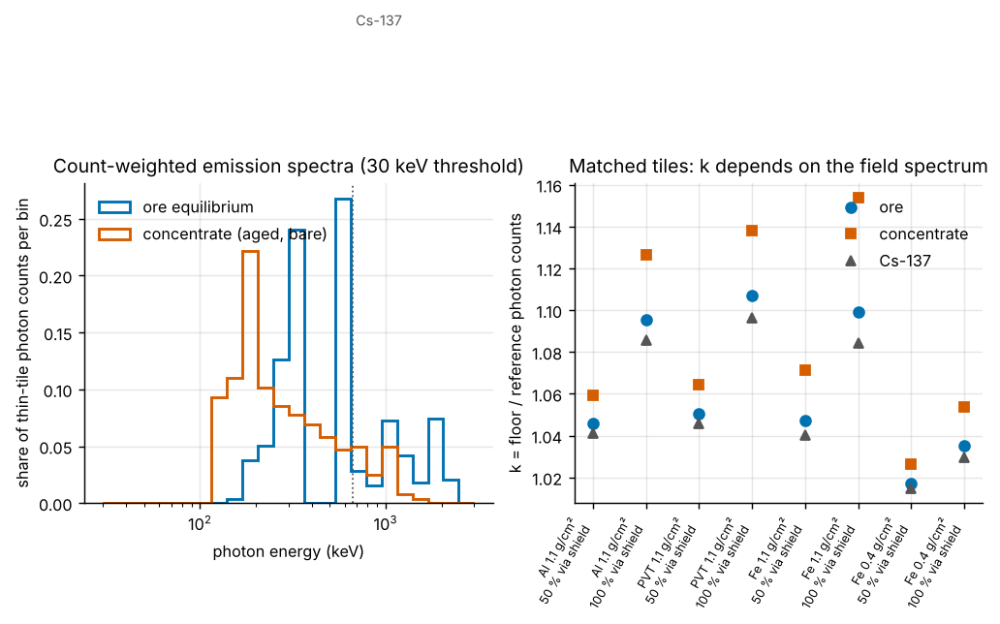
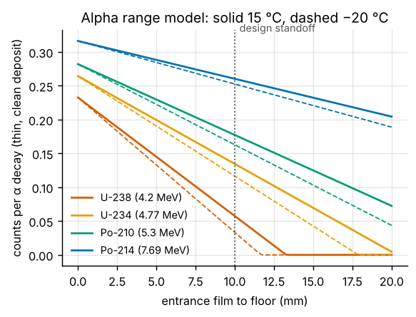
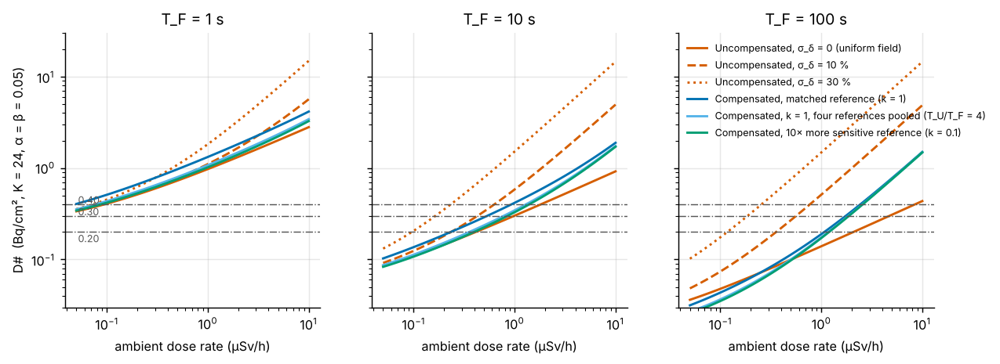
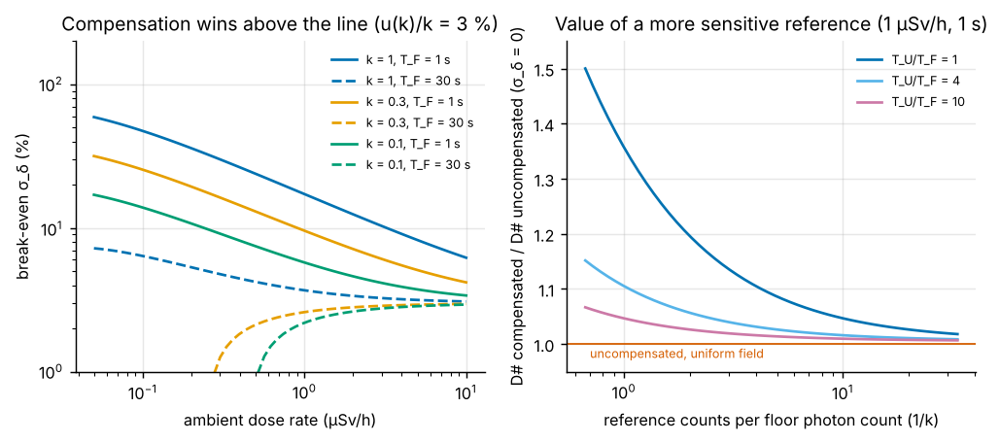
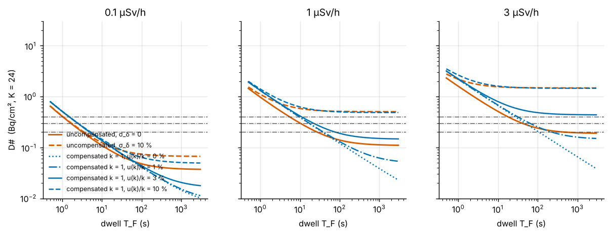
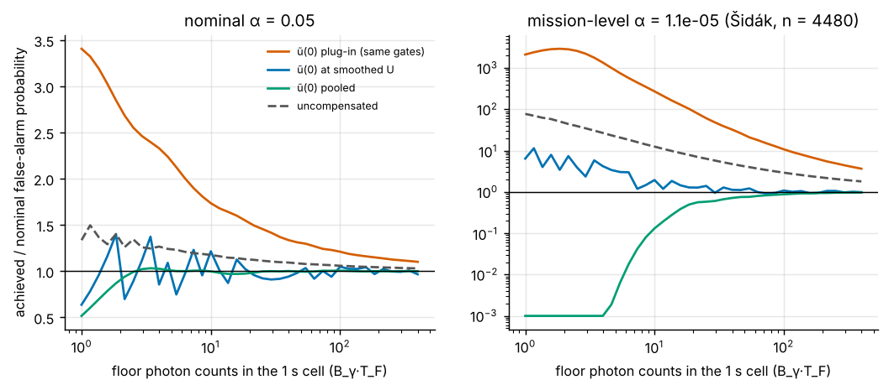
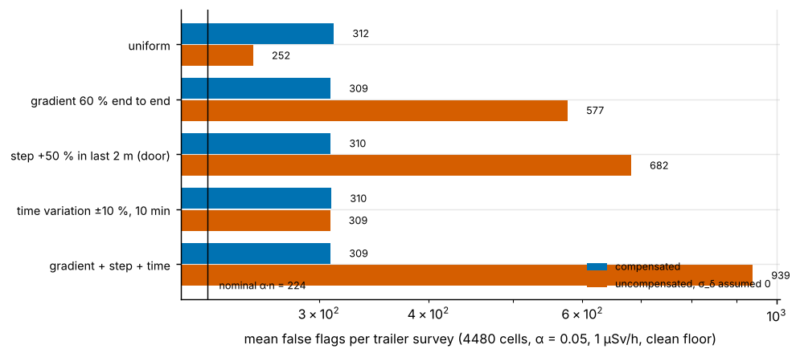
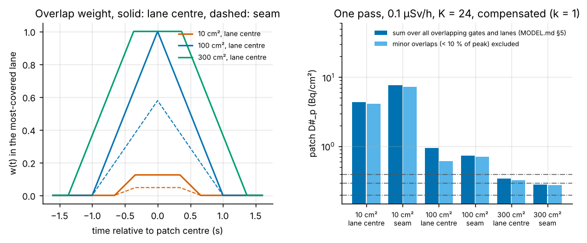
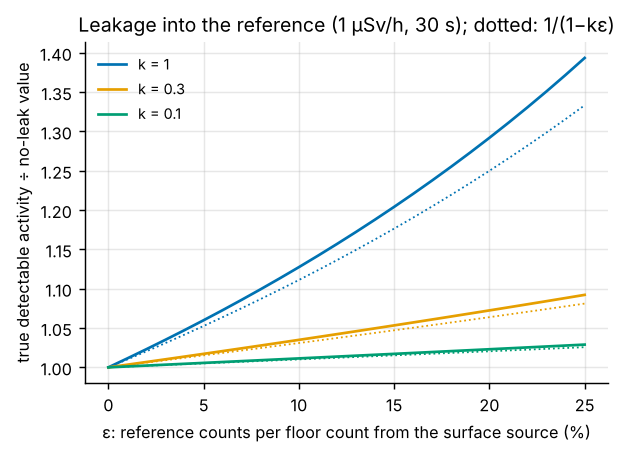

<!-- GENERATED by scripts/s6_report.py from detectability_report.template.md and results/. Edit the template. -->
# Compensated versus uncompensated detectability at equal dwell

Rad Roomba radiometry study, design baseline 0.3. Status: **calculated, no detector exists**. Every coefficient below is an assumption with a stated range; none is a measured property of the Rad Roomba head. Model definition: `analysis/radiometry/MODEL.md` (normative, not edited here). Issues found in it are in `analysis/radiometry/MODEL_REVIEW.md`. All numbers in this report are regenerated by `./run_all.sh` from `results/`.

## 1. Answer in brief

Stated for a uniform deposit covering one 80 cm² aperture, beta-window channel, K = 24 s⁻¹ per Bq/cm² (Cl-36-equivalent, assumed), u_rel(K) = 15 %, α = β = 0.05 per decision unless noted.

1. **A single 1 s pass does not reach 0.20 Bq/cm² with either estimator**, even at natural background (0.1 µSv/h): D# = 0.408 Bq/cm² uncompensated in a perfectly uniform field and 0.510 compensated with a matched reference. Both values are above the 0.40 comparison level too. The limit is counting statistics on about four background counts per second. Reaching 0.20 in 1 s needs K ≥ 48.9 (uncompensated) or K ≥ 61.2 (compensated, matched reference). K depends by more than a factor of ten on what "1 Bq/cm²" means for ore (section 2.4), which the site has not defined.
2. **In a uniform field compensation costs sensitivity**: the matched reference raises D# by a factor 1.36 at 1 µSv/h and 1 s. A reference with ten times the photon count rate (k = 0.1) reduces that penalty to 1.05; pooling the four reference tiles reduces it to 1.11.
3. **Compensation wins once the field is non-uniform** by more than the break-even σ_δ ≈ √(u²(k)/k² + k/(B_γ·T_U)): 47 % at 0.1 µSv/h, 17 % at 1 µSv/h and 10 % at 3 µSv/h for a matched reference and 1 s; 2.6 % at 1 µSv/h for a 100 s recount. With a 30 % non-uniformity at 1 µSv/h the uncompensated D# for a 30 s recount is 1.49 Bq/cm² against 0.266 compensated.
4. **u(k) sets a floor that dwell cannot remove**: D# ≥ about 2κ·B_γ·(u(k)/k)/K. With u(k)/k = 3 % it is 0.145 Bq/cm² at 1 µSv/h and 0.436 at 3 µSv/h. The 0.20 goal is unreachable at any dwell above 1.38 µSv/h (K = 24, u(k)/k = 3 %); with u(k)/k = 1 % the bound moves to 4.13 µSv/h.
5. **Dwell that reaches 0.20 Bq/cm²** (K = 24): 3.23 s uncompensated-uniform, 4.96 s compensated-matched, 3.32 s with the 10× reference at 0.1 µSv/h; 78.2 s compensated-matched at 1 µSv/h. At 0.1 µSv/h the compensated value corresponds to a scan speed of about 0.0202 m/s instead of 0.10 m/s.
6. **A per-decision α of 0.05 gives about 224 false flags per trailer** (4480 cells). A 5 % per-mission allowance needs α = 1.14e-05 per decision, which raises the single-pass D# to 0.902 Bq/cm² (compensated, 0.1 µSv/h). At that α the normal-quantile thresholds of MODEL.md §3 are not valid for 1 s counts (section 5.2).
7. **Small patches**: one pass over a 10 cm² patch centred on a lane has a patch detection limit of 4.37 Bq/cm² (43.7 Bq) at 0.1 µSv/h; 100 cm² gives 0.955 and 300 cm² gives 0.345 Bq/cm². None reaches 0.20 in one pass with K = 24.
8. **The alpha channel is not a scanning channel at 10 mm standoff**: 0.20 Bq/cm² gives about 1.20 counts per second (K_α = 6, assumed), below the three counts needed for 95 % detection with zero background. It is usable as a stationary confirmation channel if the standoff is controlled.

## 2. Parameter space and its basis

### 2.1 Assumption register

Machine-readable copy: `results/parameter_space.json`. Sources: [H7] Mirion AB-100 datasheet (docs/Sources.csv), read for this study; [NIST] X-ray mass attenuation tables for Al, Fe, vinyltoluene and air, fetched for this study; decay data are DDEP/ENSDF values transcribed from memory and not re-verified (status: unverified transcription).

| Symbol | Quantity | Nominal | Range studied | Unit | Basis / source | Status |
|---|---|---|---|---|---|---|
| A_a | aperture area | 80.0 | 80 | cm2 | design 0.3 Rev D layout (80 mm x 100 mm) | design value |
| L/v | dwell of an interior point, one pass | 1.00 | 1 (0.10 m/s) | s | MODEL.md section 5 | design value |
| H | ambient dose rate on the trailer floor | 0.100 | 0.05-5 (stress case 10) | uSv/h | natural background ~0.1; elevated near ore, loaded conveyances and mill yards; no site data | ASSUMED - needs site survey |
| S_beta | floor beta-window photon response | 33.2 | 15-90 | 1/s per uSv/h | Mirion AB-100 42 (1/s)/(uSv/h) for Cs-137, 101.25 cm2 [H7], scaled by area to 80 cm2; range covers spectrum (x0.8 ore-like to x1.8 concentrate-like in the thin-tile model), housing and threshold | ASSUMED from another product |
| S_alpha | floor alpha-channel photon response | 0.158 | 0.05-0.5 | 1/s per uSv/h | AB-100 0.2 (1/s)/(uSv/h) [H7] scaled by area | ASSUMED from another product |
| b_beta | beta-window rate not tracked by the reference | 0.500 | 0-2 | 1/s | AB-100 background <= 5 1/s at <= 0.1 uSv/h, 4.0 used for its MDA [H7]; 4.2 predicted from S alone | ASSUMED |
| b_alpha | alpha-channel intrinsic background | 0.0100 | 0.005-0.05 | 1/s | AB-100 <= 0.05 1/s, 0.01 used for MDA [H7], scaled | ASSUMED from another product |
| k | floor/reference photon count ratio | 1.00 | 1 (matched tile); 0.3; 0.1 (reference 3x/10x more sensitive) | - | matched thin tile gives k ~ 1; a thicker reference tile raises photon interactions roughly in proportion to thickness (NIST mu for vinyltoluene) | ASSUMED - design variable |
| u(k)/k | relative uncertainty of k incl. spectral mismatch | 0.0300 | 0-0.10 | - | fit component ~1 %; spectral component between ore-like and concentrate-like fields 0.4-19.0 % in the shield-attenuation model (results/k_spectral_mismatch.csv); other mechanisms unmodelled | ASSUMED - needs measurement |
| u(b) | uncertainty of the offset | 0.0500 | 0-0.2 | 1/s | long clean-floor run | ASSUMED |
| T_U/T_F | reference live time per floor live time | 1.00 | 1; 4 (four lanes pooled); 10 (running mean) | - | design choice; pooling/averaging assumes the field is uniform over the pooled extent | design variable |
| sigma_delta | relative non-uniformity of the photon field (uncompensated) | 0.200 | 0-0.5 | - | gradients along a 16 m trailer, door end, neighbouring loads, time variation; no site data | ASSUMED - needs site survey |
| T_0 | background count time, uncompensated | 60.0 | 10-600 | s | procedure choice | ASSUMED |
| K_beta | beta-window response | 24.0 | 8-100 | 1/s per Bq/cm2 | AB-100 contact responses [H7] x 80 cm2 x geometry; the value depends on what 1 Bq/cm2 means (results/K_beta_basis.csv); nominal = Cl-36-equivalent | ASSUMED - dominated by the undefined measurand |
| u_rel(K_beta) | relative uncertainty of K_beta | 0.150 | 0.10-0.30 | - | source certificate, standoff, self-absorption, floor finish | ASSUMED |
| K_alpha | alpha-channel response at 10 mm | 6.00 | 1.5-13 | 1/s per Bq/cm2 (alpha) | range model anchored to AB-100 Pu-239 [H7]: thin natural U 7.7, all ore alphas ~13, thick/dusty deposits lower | ASSUMED - model, not data |
| u_rel(K_alpha) | relative uncertainty of K_alpha | 0.350 | 0.3-0.6 | - | standoff (-15 to -30 %/mm for U-238), air density, self-absorption | ASSUMED |
| alpha,beta | per-decision error probabilities | 0.0500 | 0.05; Sidak value for the mission | - | MODEL.md section 3 default; site profile owns them | site decision |
| A_mission | per-mission false-investigation allowance | 0.0500 | 0.05 (P>=1); also expected counts 1-20 | - | not defined by the site | site decision |
| n | independent decision areas per trailer | 4.48e+03 | 1333-5000 | - | 2.5 m x 16 m; 28 lane tracks x 160 cells of 0.1 m | derived |
| eps | fraction of floor surface signal appearing in the reference | 0 | 0-0.2 | - | depends on the beta shield between the tiles (Pa-234m 2.27 MeV, Bi-214 3.27 MeV end points) | ASSUMED - needs measurement |

### 2.2 Photon emitters: ore against separated concentrate

Ore in secular equilibrium emits most of its photon energy from ²¹⁴Pb (242, 295, 352 keV) and ²¹⁴Bi (609 to 2448 keV). Chemically separated concentrate has lost ²²⁶Ra and its progeny; after ²³⁴Th and ²³⁴ᵐPa regrow (half-life 24.1 d) its photons are the 63 and 93 keV lines of ²³⁴Th, the 766 and 1001 keV lines of ²³⁴ᵐPa, the 144 to 205 keV lines of ²³⁵U, and bremsstrahlung from the 2.27 MeV ²³⁴ᵐPa beta in the uranium matrix (Kramers thick-target estimate, ±50 %). Line lists are in `results/photon_lines.csv`. The emission spectra differ strongly:

| Field (emission spectrum) | Photon MeV per U-238 decay | Kerma-weighted mean keV | Count-weighted mean keV | Counts per air kerma rel. Cs-137, thr 10 / 30 / 60 keV |
|---|---|---|---|---|
| ore equilibrium | 1.44 | 1.14e+03 | 682 | 0.965 / 0.886 / 0.813 |
| ore through 5mm steel | 1.12 | 1.19e+03 | 730 | 0.861 / 0.821 / 0.766 |
| concentrate bare | 0.0906 | 469 | 353 | 3.04 / 1.56 / 0.978 |
| concentrate through 2mm steel | 0.0691 | 556 | 370 | 2.79 / 1.74 / 1.13 |
| Cs137 calibration | n/a | 662 | 662 | 1.00 / 1.00 / 1.00 |

Ore emits about 16 times more photon energy per ²³⁸U decay than aged concentrate, and the concentrate spectrum is softer. In a thin-tile model (interaction probability in 0.25 mm vinyltoluene times the fraction of Compton electrons above threshold) the counts per unit air kerma are 0.89 (ore) and 1.6 (concentrate) relative to ¹³⁷Cs at a 30 keV threshold. Scattered photons, which soften real fields further, are not modelled.

The consequence for compensation: k is a ratio of two detector responses, and it changes with the spectrum whenever the floor and reference tiles see the field differently. The reference must be shielded from floor betas up to 2.27 MeV (²³⁴ᵐPa) and 3.27 MeV (²¹⁴Bi), about 1.1 g/cm² of absorber; that absorber attenuates low-energy photons arriving from below. For two identical thin tiles and that mechanism alone:

| Beta shield | g/cm2 | Fraction of photons through shield | Threshold keV | k Cs-137 | k ore | k concentrate | Δk/k conc. vs ore | Δk/k conc. vs Cs-137 |
|---|---|---|---|---|---|---|---|---|
| Al | 1.10 | 0.500 | 30.0 | 1.041 | 1.046 | 1.059 | 1.3 % | 1.8 % |
| Al | 1.10 | 1.00 | 30.0 | 1.086 | 1.096 | 1.126 | 2.8 % | 3.8 % |
| PVT | 1.10 | 0.500 | 30.0 | 1.046 | 1.051 | 1.065 | 1.3 % | 1.8 % |
| PVT | 1.10 | 1.00 | 30.0 | 1.096 | 1.107 | 1.138 | 2.8 % | 3.8 % |
| Fe | 1.10 | 0.500 | 30.0 | 1.040 | 1.047 | 1.071 | 2.3 % | 3.0 % |
| Fe | 1.10 | 1.00 | 30.0 | 1.084 | 1.099 | 1.154 | 5.0 % | 6.4 % |
| Fe | 0.400 | 0.500 | 30.0 | 1.015 | 1.017 | 1.026 | 0.9 % | 1.1 % |
| Fe | 0.400 | 1.00 | 30.0 | 1.030 | 1.035 | 1.054 | 1.8 % | 2.3 % |

With a 30 keV threshold the mismatch between ore-like and concentrate-like fields is 1 to 5 %. Across thresholds of 10 to 60 keV and the shield options in `results/k_spectral_mismatch.csv` it spans 0.4 to 19.0 %; a k fitted in a ¹³⁷Cs beam differs from the concentrate value by up to 22.8 %. A low-Z shield (aluminium or the plastic light guide) keeps the mismatch smaller than steel. A thicker reference tile adds differences in wall-electron response and threshold behaviour that this model does not capture and that must be measured. The study therefore treats u(k)/k as 0 to 10 % with 3 % nominal.

### 2.3 Ambient dose rate and photon count rates

No site data exist. Natural background is about 0.05 to 0.15 µSv/h. An empty trailer at a uranium facility may stand near loaded conveyances, ore pads or mill buildings; an IAEA training figure of about 45 µSv/h per % U₃O₈ on contact with ore (search-result snippet; the document could not be opened) implies tens to hundreds of µSv/h at loaded high-grade conveyances, so 1 to a few µSv/h on a nearby empty floor is plausible. The study uses 0.05 to 5 µSv/h with 10 µSv/h as a stress case. **This range needs a site survey.**

Floor photon count rate: B_γ = S_β·Ḣ with S_β = 33.2 s⁻¹ per µSv/h, the AB-100 ¹³⁷Cs beta-channel value (42 for 101 cm²) scaled to 80 cm². A fluence check supports the order of magnitude: 1 µSv/h of 662 keV photons is about 82 cm⁻² s⁻¹, and 0.25 mm of plastic interacts with 0.22 % of them, giving about 18 s⁻¹ per 100 cm² before wall electrons. The range 15 to 90 covers spectrum, housing and threshold.

| Ambient dose rate µSv/h | Floor beta-window photon rate B_γ, nominal (range) s⁻¹ | Beta-window total B s⁻¹ | Alpha-channel total s⁻¹ |
|---|---|---|---|
| 0.0500 | 1.66 (0.750–4.50) | 2.16 | 0.0179 |
| 0.100 | 3.32 (1.50–9.00) | 3.82 | 0.0258 |
| 0.300 | 9.96 (4.50–27.0) | 10.5 | 0.0574 |
| 1.00 | 33.2 (15.0–90.0) | 33.7 | 0.168 |
| 3.00 | 99.6 (45.0–270) | 100 | 0.484 |
| 10.0 | 332 (150–900) | 332 | 1.59 |

The reference rate is U = B_γ/k. A matched tile gives k ≈ 1. Photon interactions in thin plastic scale nearly linearly with thickness (NIST µ), so a reference tile several millimetres thick gives k of 0.1 to 0.3.

### 2.4 Surface response K of the beta window

K = (counts per decay) × 80 cm² × geometry. Counts per decay are read across from AB-100 contact responses by beta end-point energy. The dominant uncertainty is not the detector but the measurand: the same deposit has a K that differs by more than ten times depending on which activity "1 Bq/cm²" counts.

| Meaning of “1 Bq/cm²” | K at anchor geometry | K, aperture-size source at 10 mm | K, wide source at 10 mm |
|---|---|---|---|
| Cl-36 equivalent (calibration source basis) | 24.0 | 18.4 | 28.4 |
| Sr-90/Y-90 equivalent, per Bq of Sr-90 | 49.6 | 38.0 | 58.8 |
| ore, per Bq of U-238 (chain in equilibrium) | 103 | 79.1 | 122 |
| ore, per Bq of gross alpha (8 alpha per U-238 decay) | 12.9 | 9.88 | 15.3 |
| ore, per Bq of total chain activity (14 decays) | 7.37 | 5.65 | 8.73 |
| aged concentrate, per Bq of U-238 | 30.4 | 23.3 | 36.0 |
| aged concentrate, per Bq of gross alpha (U-238 + U-234 + U-235) | 14.9 | 11.4 | 17.6 |

Geometry: for isotropic emission without absorption, a source the size of the aperture at 10 mm delivers 0.647 of its 2π emission to the aperture, against 0.844 at 3 mm (ratio 0.766); a source much wider than the aperture loses nothing. Radon loss from thin dust and self-absorption lower the ore values: with 30 % radon loss the per-²³⁸U value for the aperture-size geometry falls to about 68. Fresh concentrate has almost no beta emission until ²³⁴Th/²³⁴ᵐPa regrow. The study uses K = 8, 13, 24, 50 and 100; D# is exactly proportional to 1/K at fixed u_rel(K), so every D# below can be rescaled by 24/K.

### 2.5 Is the alpha channel viable at 10 mm?

A range model (air range 1.24E − 2.62 cm for 4 to 8 MeV, window 0.84 mg/cm² ≈ 7 mm air-equivalent, 1 MeV residual-energy threshold, scaled by 0.71 to reproduce the AB-100 ²³⁹Pu efficiency) gives counts per alpha decay for a thin, clean deposit:

| Nuclide (α MeV) | 3 mm | 8 mm | 10 mm | 12 mm | 15 mm | 10 mm at −20 °C |
|---|---|---|---|---|---|---|
| U-238 (4.2) | 0.180 | 0.0925 | 0.0575 | 0.0224 | 0 | 0.0333 |
| U-234 (4.77) | 0.225 | 0.160 | 0.134 | 0.108 | 0.0695 | 0.117 |
| Ra-226 (4.78) | 0.226 | 0.161 | 0.135 | 0.110 | 0.0708 | 0.118 |
| Po-210 (5.3) | 0.251 | 0.198 | 0.177 | 0.156 | 0.125 | 0.163 |
| Po-214 (7.69) | 0.300 | 0.272 | 0.260 | 0.249 | 0.232 | 0.253 |

The 4.2 MeV alpha of ²³⁸U has a 2.6 cm range, of which the gap and window consume 1.7 cm at normal incidence. For thin natural uranium the efficiency is about 9.6 % at 10 mm (20.3 % at 3 mm), K_α ≈ 7.7 s⁻¹ per Bq/cm². It falls by 32 % if the gap opens to 12 mm and by 22 % at −20 °C because the air is denser. Dust loading, ore grains and rough floors degrade the alpha spectrum further; this is not modelled. Implications: (i) K_α carries a relative uncertainty of at least 30 %, and the detection limit is undefined once κ·u_rel(K) ≥ 1 (u_rel ≥ 61 %); (ii) the standoff must be measured during the survey, not assumed, if alpha results are to be quantitative; (iii) the scan decision has to rest on the beta window.

## 3. Equations and their implementation

| MODEL.md | Quantity | Function in `rrrad` |
|---|---|---|
| §2 | r = F − k·U − b; u²(r) counting and transfer terms; D, u(D) | `model.net_rate`, `u2_counting`, `u2_transfer`, `estimate` |
| §3 | ũ²(0), r\*, r#, D\*, D# (closed form for α = β and for α ≠ β; Brent solve) | `model.u0sq_comp`, `decision_threshold`, `detection_limit_rate`, `detection_limit_activity`, `*_numeric` |
| §3 | Šidák per-decision α | `model.sidak_alpha` |
| §4 | Uncompensated ũ²(0) | `model.u0sq_unc`, `unc_limits` |
| §5 | Gate integral of w(t), summed T_S and W_S, patch limit | `patch.gate_weights`, `patch_sum`, `patch_dhash` |
| — | Exact Poisson error probabilities | `exact.comp_flag_probability`, `unc_flag_probability` |
| — | Leakage ε | `model.leak_detection_limit_rate` |

With B_γ = k·U the compensated null variance is ũ²(0) = (B_γ + b)/T_F + k·B_γ/T_U + B_γ²·(u(k)/k)² + u²(b) + 2U·cov(k,b). The uncompensated one is B/T_F + B₀/T₀ + σ_δ²B². The two have the same structure: the reference replaces the field term σ_δ²B² by B_γ²(u(k)/k)² and the background-count term B₀/T₀ by k·B_γ/T_U. u(k) is applied to the whole reference rate with cov(k,b) = 0, which is exact for a spectral mismatch and conservative for a pure fit uncertainty near the centre of the fitted range.

## 4. Analytic comparison at equal dwell

Nominal case: S_β = 33.2 s⁻¹ per µSv/h, b = 0.5 s⁻¹, u(b) = 0.05 s⁻¹, u(k)/k = 3 %, T₀ = 60 s, K = 24, u_rel(K) = 15 % (which multiplies every D# by 1.06). Full grids: `results/analytic_comp_grid.csv`, `results/analytic_unc_grid.csv`.

### 4.1 D# by field, dwell and estimator

| Estimator | T_F (s) | D# at 0.1 µSv/h | D# at 0.3 µSv/h | D# at 1.0 µSv/h | D# at 3.0 µSv/h |
|---|---|---|---|---|---|
| Uncompensated, σ_δ = 0 (uniform field) | 1.00 | 0.408 | 0.596 | 0.974 | 1.59 |
| Uncompensated, σ_δ = 0 (uniform field) | 10.0 | 0.109 | 0.173 | 0.301 | 0.511 |
| Uncompensated, σ_δ = 0 (uniform field) | 100 | 0.0478 | 0.0783 | 0.140 | 0.240 |
| Uncompensated, σ_δ = 10 % | 1.00 | 0.413 | 0.620 | 1.11 | 2.19 |
| Uncompensated, σ_δ = 10 % | 10.0 | 0.124 | 0.234 | 0.582 | 1.56 |
| Uncompensated, σ_δ = 10 % | 100 | 0.0738 | 0.172 | 0.512 | 1.48 |
| Uncompensated, σ_δ = 30 % | 1.00 | 0.453 | 0.780 | 1.82 | 4.74 |
| Uncompensated, σ_δ = 30 % | 10.0 | 0.206 | 0.497 | 1.52 | 4.42 |
| Uncompensated, σ_δ = 30 % | 100 | 0.175 | 0.465 | 1.48 | 4.39 |
| Compensated, matched reference (k = 1) | 1.00 | 0.510 | 0.781 | 1.32 | 2.23 |
| Compensated, matched reference (k = 1) | 10.0 | 0.136 | 0.225 | 0.417 | 0.796 |
| Compensated, matched reference (k = 1) | 100 | 0.0434 | 0.0806 | 0.189 | 0.483 |
| Compensated, k = 1, four references pooled (T_U/T_F = 4) | 1.00 | 0.435 | 0.647 | 1.08 | 1.81 |
| Compensated, k = 1, four references pooled (T_U/T_F = 4) | 10.0 | 0.113 | 0.184 | 0.345 | 0.687 |
| Compensated, k = 1, four references pooled (T_U/T_F = 4) | 100 | 0.0366 | 0.0698 | 0.175 | 0.467 |
| Compensated, 10× more sensitive reference (k = 0.1) | 1.00 | 0.418 | 0.616 | 1.02 | 1.71 |
| Compensated, 10× more sensitive reference (k = 0.1) | 10.0 | 0.107 | 0.174 | 0.328 | 0.663 |
| Compensated, 10× more sensitive reference (k = 0.1) | 100 | 0.0351 | 0.0675 | 0.172 | 0.463 |

### 4.2 Regimes

**Where compensation loses.** In a uniform, low field the reference adds the counting variance k·B_γ/T_U and nothing else changes. For a matched tile and equal live time the null variance doubles, the classical paired-blank result, and D# rises by up to √2. This penalty shrinks in proportion to k·T_F/T_U: a reference with more photon counts per floor photon count, or reference counts pooled over the four lanes or over a longer window, recovers most of it. Pooling assumes the field is uniform over the pooled extent.

**Break-even.** Compensation has the lower D# when σ_δ exceeds the value below (u(k)/k = 3 %, T_U = T_F; "always wins" means the 60 s background count of the uncompensated procedure already costs more than the reference).

| T_F (s) | k | 0.05 µSv/h | 0.1 µSv/h | 0.3 µSv/h | 1.0 µSv/h | 3.0 µSv/h | 10.0 µSv/h |
|---|---|---|---|---|---|---|---|
| 1.00 | 1.00 | 59 % | 47 % | 30 % | 17 % | 10 % | 6 % |
| 1.00 | 0.300 | 32 % | 25 % | 16 % | 10 % | 6 % | 4 % |
| 1.00 | 0.100 | 17 % | 14 % | 9 % | 6 % | 4 % | 3 % |
| 100 | 1.00 | 0 (always wins) | 0 (always wins) | 1 % | 3 % | 3 % | 3 % |
| 100 | 0.300 | 0 (always wins) | 0 (always wins) | 0 (always wins) | 2 % | 3 % | 3 % |
| 100 | 0.100 | 0 (always wins) | 0 (always wins) | 0 (always wins) | 2 % | 3 % | 3 % |

**Floor from u(k).** As T_F and T_U grow, ũ(0) tends to B_γ·u(k)/k and D# to 2κ·B_γ·(u(k)/k)/(K(1 − κ²u_rel²(K))). A spectral mismatch is a fixed bias inside one site, so no dwell, averaging or number of passes reduces it.

| u(k)/k | Floor at 0.3 µSv/h | Floor at 1.0 µSv/h | Floor at 3.0 µSv/h | Floor at 10.0 µSv/h | Max µSv/h for floor ≤ 0.20 (K = 24) | Max µSv/h for floor ≤ 0.20 (K = 100) |
|---|---|---|---|---|---|---|
| 1 % | 0.0145 | 0.0484 | 0.145 | 0.484 | 4.13 | 17.2 |
| 3 % | 0.0436 | 0.145 | 0.436 | 1.45 | 1.38 | 5.73 |
| 5 % | 0.0727 | 0.242 | 0.727 | 2.42 | 0.826 | 3.44 |
| 10 % | 0.145 | 0.484 | 1.45 | 4.84 | 0.413 | 1.72 |

The uncompensated estimator has the same kind of floor, 2κ·σ_δ·B/K, with σ_δ in place of u(k)/k. Compensation is worth having exactly when u(k)/k can be made smaller than σ_δ.

### 4.3 Against 0.20, 0.30 and 0.40 Bq/cm²

Cells are "D# at α = 0.05 / D# at the mission-level α = 1.14e-05" in Bq/cm² for K = 24.

One pass (T_F = 1 s):

| Estimator (T_F = 1 s) | 0.1 µSv/h | 0.3 µSv/h | 1.0 µSv/h | 3.0 µSv/h |
|---|---|---|---|---|
| Uncompensated, σ_δ = 0 (uniform field) | 0.408 / 0.706 | 0.596 / 1.06 | 0.974 / 1.78 | 1.59 / 2.93 |
| Uncompensated, σ_δ = 10 % | 0.413 / 0.716 | 0.620 / 1.11 | 1.11 / 2.02 | 2.19 / 4.06 |
| Uncompensated, σ_δ = 30 % | 0.453 / 0.792 | 0.780 / 1.41 | 1.82 / 3.37 | 4.74 / 8.82 |
| Compensated, matched reference (k = 1) | 0.510 / 0.902 | 0.781 / 1.41 | 1.32 / 2.43 | 2.23 / 4.12 |
| Compensated, k = 1, four references pooled (T_U/T_F = 4) | 0.435 / 0.758 | 0.647 / 1.16 | 1.08 / 1.97 | 1.81 / 3.34 |
| Compensated, 10× more sensitive reference (k = 0.1) | 0.418 / 0.725 | 0.616 / 1.10 | 1.02 / 1.86 | 1.71 / 3.16 |

Two passes summed (T_F = 2 s) are tabulated in `results/headline_dhash.csv`. With K = 24 neither one nor two passes reach 0.20 at 0.1 µSv/h or above, with either estimator; at 0.1 µSv/h two uncompensated passes in a uniform field give 0.265 and two compensated passes 0.336. The single-pass compensated value at 0.1 µSv/h is 1.53 for K = 8, 0.245 for K = 50 and 0.122 for K = 100. Only the upper end of the K range (ore, activity expressed per Bq of ²³⁸U with the chain in equilibrium) meets 0.20 in one pass, and only up to about 0.3 µSv/h.

Dwell needed for D# ≤ 0.20 (α = β = 0.05; other levels and the mission-level α are in `results/dwell_required.csv`):

| Estimator | K | T_F (s) at 0.1 µSv/h | T_F (s) at 0.3 µSv/h | T_F (s) at 1.0 µSv/h | T_F (s) at 3.0 µSv/h |
|---|---|---|---|---|---|
| Uncompensated, σ_δ = 0 (uniform field) | 24.0 | 3.23 | 7.41 | 27.3 | 487 |
| Uncompensated, σ_δ = 0 (uniform field) | 100 | 0.346 | 0.576 | 1.33 | 3.53 |
| Uncompensated, σ_δ = 10 % | 24.0 | 3.53 | 20.8 | not reachable | not reachable |
| Uncompensated, σ_δ = 10 % | 100 | 0.348 | 0.597 | 2.07 | not reachable |
| Uncompensated, σ_δ = 30 % | 24.0 | 12.0 | not reachable | not reachable | not reachable |
| Uncompensated, σ_δ = 30 % | 100 | 0.363 | 0.843 | not reachable | not reachable |
| Compensated, matched reference (k = 1) | 24.0 | 4.96 | 12.7 | 78.2 | not reachable |
| Compensated, matched reference (k = 1) | 100 | 0.462 | 0.894 | 2.40 | 8.82 |
| Compensated, k = 1, four references pooled (T_U/T_F = 4) | 24.0 | 3.60 | 8.47 | 50.0 | not reachable |
| Compensated, k = 1, four references pooled (T_U/T_F = 4) | 100 | 0.376 | 0.655 | 1.61 | 5.67 |
| Compensated, 10× more sensitive reference (k = 0.1) | 24.0 | 3.32 | 7.62 | 44.4 | not reachable |
| Compensated, 10× more sensitive reference (k = 0.1) | 100 | 0.358 | 0.607 | 1.45 | 5.04 |

For the compensated, matched estimator with K = 24 the dwell for 0.30 and 0.40 Bq/cm² is 2.43 s and 1.49 s at 0.1 µSv/h, and 21.7 s and 10.9 s at 1 µSv/h.

K needed for D# ≤ 0.20 in one pass (two passes in `results/K_required.csv`):

| Estimator (T_F = 1 s) | K needed at 0.1 µSv/h | K needed at 0.3 µSv/h | K needed at 1.0 µSv/h | K needed at 3.0 µSv/h |
|---|---|---|---|---|
| Uncompensated, σ_δ = 0 (uniform field) | 48.9 | 71.5 | 117 | 191 |
| Uncompensated, σ_δ = 10 % | 49.6 | 74.4 | 133 | 263 |
| Uncompensated, σ_δ = 30 % | 54.3 | 93.6 | 219 | 569 |
| Compensated, matched reference (k = 1) | 61.2 | 93.7 | 159 | 267 |
| Compensated, k = 1, four references pooled (T_U/T_F = 4) | 52.2 | 77.6 | 129 | 217 |
| Compensated, 10× more sensitive reference (k = 0.1) | 50.1 | 73.9 | 122 | 205 |

Options that would bring a moving scan to 0.20 for K ≈ 24, in order of leverage: (a) slow the scan or lengthen the aperture along travel so that the dwell is about 4 to 5 s at natural background; (b) a more sensitive or pooled reference to remove the counting penalty; (c) lower the floor tile's photon response (thinner plastic, higher threshold) at constant beta efficiency, since D# ∝ √B; (d) a scan-then-recount rule (section 4.4). None helps above the dose rate at which the u(k) floor exceeds the goal.

### 4.4 Mission-level false alarms and a scan-plus-recount rule

A trailer of 2.5 m × 16 m holds 4480 cells of one aperture by 0.1 m. At α = 0.05 per decision the expected number of false flags is 224. The Šidák value for a 5 % chance of any false investigation per mission is α = 1.14e-05 (κ = 4.23).

A two-stage rule spends the allowance more efficiently: scan at a looser α₁, then recount each flagged cell stationary for 30 s at α₂ = (mission α)/α₁, with β = 0.025 at each stage. The overall detection limit is the larger of the two stage limits:

| Estimator | µSv/h | Expected false recounts per trailer | α scan | D# scan (1 s) | D# recount (30 s) | D# overall | Recount dwell (min) |
|---|---|---|---|---|---|---|---|
| Compensated, matched reference (k = 1) | 0.100 | 5.00 | 0.0011 | 0.831 | 0.105 | 0.831 | 2.50 |
| Compensated, matched reference (k = 1) | 0.100 | 20.0 | 0.0045 | 0.759 | 0.117 | 0.759 | 10.0 |
| Compensated, matched reference (k = 1) | 0.100 | 100 | 0.022 | 0.661 | 0.130 | 0.661 | 50.0 |
| Compensated, matched reference (k = 1) | 1.00 | 5.00 | 0.0011 | 2.14 | 0.359 | 2.14 | 2.50 |
| Compensated, matched reference (k = 1) | 1.00 | 20.0 | 0.0045 | 1.94 | 0.404 | 1.94 | 10.0 |
| Compensated, matched reference (k = 1) | 1.00 | 100 | 0.022 | 1.67 | 0.449 | 1.67 | 50.0 |

The recount stage is much more sensitive than the scan stage, so the scan stage sets the overall limit, and accepting more recounts buys only a modest improvement. A recount rule therefore controls false investigations cheaply but does not by itself deliver 0.20 Bq/cm²; the scan dwell or K has to change.

### 4.5 Alpha channel

Compensated alpha-channel D# for the assumed K_α range, with k_α = 0.0048 (alpha-channel photon counts per reference count) and u_rel(K_α) = 35 %, which multiplies D# by 1.50:

| K_α | µSv/h | D# at 1 s | D# at 2 s | D# at 10 s | D# at 30 s | D# at 100 s |
|---|---|---|---|---|---|---|
| 1.50 | 0.100 | 3.23 | 1.72 | 0.437 | 0.187 | 0.0809 |
| 1.50 | 1.00 | 4.05 | 2.30 | 0.699 | 0.342 | 0.172 |
| 6.00 | 0.100 | 0.806 | 0.431 | 0.109 | 0.0467 | 0.0202 |
| 6.00 | 1.00 | 1.01 | 0.576 | 0.175 | 0.0854 | 0.0429 |
| 13.0 | 0.100 | 0.372 | 0.199 | 0.0504 | 0.0216 | 0.00934 |
| 13.0 | 1.00 | 0.467 | 0.266 | 0.0807 | 0.0394 | 0.0198 |

The alpha background is so low that the reference contributes almost nothing; the limit is the κ²/T_F term, that is, the need for a few counts. At 1 s the nominal value is 0.806 Bq/cm²; a 10 s stationary count gives 0.109. At these count levels the normal approximation is itself poor (2.71 counts where the Poisson requirement is 3.0).

## 5. Monte Carlo and exact-Poisson validation

Truth and rule are separated: the truth has a transfer coefficient k(1 + m) with a spectral mismatch m ~ N(0, 3 %) and Poisson counts; the rule uses an estimate k̂ with a 1 % fit error and declares u(k)/k = √(1² + 3²) %. Each calibration error is drawn once per simulated calibration. Seeds are fixed.

### 5.1 Achieved error probabilities at α = β = 0.05

200 000 trials per point; full grid of four dose rates and five dwell times in `results/mc_point_validation.csv`.

| µSv/h | T_F (s) | Rule | Achieved false-alarm probability (nominal 0.050) | Achieved detection probability at analytic r# (nominal 0.950) |
|---|---|---|---|---|
| 0.100 | 1.00 | compensated k = 1, ũ(0) plug-in (same gates) | 0.115 | 0.933 |
| 0.100 | 1.00 | compensated k = 1, ũ(0) at true/smoothed U | 0.062 | 0.960 |
| 0.100 | 1.00 | compensated k = 1, ũ(0) pooled | 0.052 | 0.880 |
| 0.100 | 1.00 | uncompensated, σ_δ = 20 % declared | 0.064 | 0.959 |
| 0.100 | 1.00 | uncompensated, σ_δ = 20 % present but not declared | 0.076 | — |
| 0.100 | 30.0 | compensated k = 1, ũ(0) plug-in (same gates) | 0.060 | 0.943 |
| 0.100 | 30.0 | compensated k = 1, ũ(0) at true/smoothed U | 0.051 | 0.951 |
| 0.100 | 30.0 | compensated k = 1, ũ(0) pooled | 0.049 | 0.932 |
| 0.100 | 30.0 | uncompensated, σ_δ = 20 % declared | 0.057 | 0.948 |
| 0.100 | 30.0 | uncompensated, σ_δ = 20 % present but not declared | 0.209 | — |
| 1.00 | 1.00 | compensated k = 1, ũ(0) plug-in (same gates) | 0.069 | 0.938 |
| 1.00 | 1.00 | compensated k = 1, ũ(0) at true/smoothed U | 0.050 | 0.951 |
| 1.00 | 1.00 | compensated k = 1, ũ(0) pooled | 0.050 | 0.919 |
| 1.00 | 1.00 | uncompensated, σ_δ = 20 % declared | 0.057 | 0.955 |
| 1.00 | 1.00 | uncompensated, σ_δ = 20 % present but not declared | 0.141 | — |
| 1.00 | 30.0 | compensated k = 1, ũ(0) plug-in (same gates) | 0.054 | 0.948 |
| 1.00 | 30.0 | compensated k = 1, ũ(0) at true/smoothed U | 0.051 | 0.950 |
| 1.00 | 30.0 | compensated k = 1, ũ(0) pooled | 0.048 | 0.942 |
| 1.00 | 30.0 | uncompensated, σ_δ = 20 % declared | 0.052 | 0.949 |
| 1.00 | 30.0 | uncompensated, σ_δ = 20 % present but not declared | 0.378 | — |

Findings over the full grid:

- With ũ(0) evaluated at the true (or independently smoothed) reference rate, the compensated rule achieves false-alarm probabilities of 0.045 to 0.062 and detection probabilities at the analytic r# of 0.949 to 0.960. The analytic model is confirmed, including the calibration terms; the residual deviations occur at about four counts per cell and come from the integer counts.
- With ũ(0) evaluated at the reference rate of the same gates (the literal reading of MODEL.md §3) the false-alarm probability is 0.051 to 0.115: a low reference count lowers the threshold and raises r at the same time.
- The uncompensated rule with σ_δ declared achieves 0.049 to 0.064 and 0.944 to 0.959. If a real 20 % non-uniformity is not declared, its false-alarm probability rises to tens of per cent and grows with dwell.

### 5.2 Mission-level α: the normal quantiles fail at low counts

Exact Poisson sums, no calibration uncertainty, matched reference. Columns 3 to 6 are achieved ÷ nominal false-alarm probability at α = 1.14e-05; the last two compare the exactly computed detectable rate (threshold recalibrated to hold α) with the formula.

| µSv/h | T_F (s) | Comp., ũ(0) plug-in | Comp., ũ(0) at true/smoothed U | Comp., ũ(0) pooled | Uncompensated | Exact r# / formula r#, compensated | Exact r# / formula r#, uncompensated |
|---|---|---|---|---|---|---|---|
| 0.100 | 1.00 | 1.86e+03 | 4.90 | 8.16e-05 | 31.3 | 1.09 | 1.19 |
| 0.100 | 2.00 | 431 | 3.51 | 0.0207 | 18.3 | 1.06 | 1.15 |
| 0.100 | 10.0 | 31.4 | 1.46 | 0.547 | 7.37 | 1.01 | 1.11 |
| 0.300 | 1.00 | 274 | 1.85 | 0.129 | 12.6 | 1.02 | 1.12 |
| 0.300 | 2.00 | 78.6 | 0.992 | 0.445 | 7.78 | 1.01 | 1.10 |
| 0.300 | 10.0 | 10.2 | 1.08 | 0.836 | 3.73 | 1.01 | 1.06 |
| 1.00 | 1.00 | 40.6 | 0.969 | 0.652 | 5.29 | 1.00 | 1.07 |
| 1.00 | 2.00 | 16.7 | 1.30 | 0.801 | 3.69 | 1.01 | 1.06 |
| 1.00 | 10.0 | 4.03 | 1.02 | 0.957 | 2.19 | 1.01 | 1.04 |
| 3.00 | 1.00 | 10.8 | 1.00 | 0.874 | 2.94 | 1.01 | 1.04 |
| 3.00 | 2.00 | 5.87 | 1.05 | 0.941 | 2.28 | 1.01 | 1.03 |
| 3.00 | 10.0 | 2.32 | 0.976 | 0.990 | 1.60 | 1.00 | 1.02 |

At 0.1 µSv/h and 1 s the literal plug-in rule exceeds the nominal α by a factor 1.86e+03, about 95.4 false flags per trailer where 0.05 were intended. Evaluating ũ(0) at a smoothed reference rate removes most of this (factor 4.90); the remainder, and the factor 31.3 of the uncompensated rule, is the Poisson tail being heavier than the normal tail. A pooled null estimate holds α but loses power at small α: its detection probability at the formula r# is 0.30 at 0.1 µSv/h and 1 s, where 0.95 is intended. Once the threshold is recalibrated to hold α, the exactly computed r# exceeds the formula by a factor of 1.00 to 1.09 (compensated) and 1.02 to 1.19 (uncompensated): the D# values of section 4 at the mission-level α are optimistic by up to that factor.

### 5.3 False flags per trailer in structured fields

1000 simulated surveys of a clean floor per row, 4480 cells each, serpentine path at 0.10 m/s, 1 µSv/h at the reference position (0.3 µSv/h in `results/mc_survey_flags.csv`). "σ_δ equiv." is the rms relative deviation of the field from its value where B₀ was measured (trailer centre, 60 s).

| Field along the trailer (1 µSv/h) | σ_δ equiv. | Rule | Nominal expected flags | Comp. mean | Comp. 95th pct | Comp. P(≥1) | Uncomp. mean | Uncomp. 95th pct | Uncomp. P(≥1) |
|---|---|---|---|---|---|---|---|---|---|
| uniform | 0 % | α 0.05; ũ(0) plug-in; uncomp. σ_δ assumed 0 | 224 | 312 | 430 | 1.00 | 252 | 397 | 1.00 |
| uniform | 0 % | α 0.05; ũ(0) smoothed; uncomp. σ_δ declared | 224 | 224 | 349 | 1.00 | 245 | 378 | 1.00 |
| uniform | 0 % | α Sidak; ũ(0) smoothed; uncomp. σ_δ declared | 0.0513 | 0.0740 | 1.00 | 0.0700 | 0.295 | 1.00 | 0.240 |
| gradient 60 % end to end | 17 % | α 0.05; ũ(0) plug-in; uncomp. σ_δ assumed 0 | 224 | 309 | 447 | 1.00 | 577 | 767 | 1.00 |
| gradient 60 % end to end | 17 % | α 0.05; ũ(0) smoothed; uncomp. σ_δ declared | 224 | 227 | 349 | 1.00 | 260 | 375 | 1.00 |
| gradient 60 % end to end | 17 % | α Sidak; ũ(0) smoothed; uncomp. σ_δ declared | 0.0513 | 0.0810 | 1.00 | 0.0760 | 0.106 | 1.00 | 0.0960 |
| step +50 % in last 2 m (door) | 17 % | α 0.05; ũ(0) plug-in; uncomp. σ_δ assumed 0 | 224 | 309 | 444 | 1.00 | 682 | 822 | 1.00 |
| step +50 % in last 2 m (door) | 17 % | α 0.05; ũ(0) smoothed; uncomp. σ_δ declared | 224 | 226 | 346 | 1.00 | 419 | 506 | 1.00 |
| step +50 % in last 2 m (door) | 17 % | α Sidak; ũ(0) smoothed; uncomp. σ_δ declared | 0.0513 | 0.0580 | 1.00 | 0.0540 | 4.01 | 9.00 | 0.953 |
| time variation ±10 %, 10 min | 7 % | α 0.05; ũ(0) plug-in; uncomp. σ_δ assumed 0 | 224 | 310 | 443 | 1.00 | 309 | 454 | 1.00 |
| time variation ±10 %, 10 min | 7 % | α 0.05; ũ(0) smoothed; uncomp. σ_δ declared | 224 | 226 | 343 | 1.00 | 255 | 392 | 1.00 |
| time variation ±10 %, 10 min | 7 % | α Sidak; ũ(0) smoothed; uncomp. σ_δ declared | 0.0513 | 0.0500 | 0 | 0.0460 | 0.305 | 1.00 | 0.250 |
| gradient + step + time | 32 % | α 0.05; ũ(0) plug-in; uncomp. σ_δ assumed 0 | 224 | 309 | 437 | 1.00 | 939 | 1.07e+03 | 1.00 |
| gradient + step + time | 32 % | α 0.05; ũ(0) smoothed; uncomp. σ_δ declared | 224 | 224 | 346 | 1.00 | 444 | 504 | 1.00 |
| gradient + step + time | 32 % | α Sidak; ũ(0) smoothed; uncomp. σ_δ declared | 0.0513 | 0.0670 | 1.00 | 0.0650 | 1.31 | 4.00 | 0.640 |

- The compensated count does not depend on the field structure: about 224 at α = 0.05 with the smoothed threshold in every scenario (312 with the plug-in threshold).
- The uncompensated count with σ_δ assumed zero rises from 252 (uniform) to 577 (gradient) and 939 (gradient, door step and time variation). Declaring σ_δ approximately restores the mean for a smooth gradient (260) at the cost of the much larger D# of section 4, but not for a step: a Gaussian σ_δ does not describe a field in which one region is 50 % higher, and the flags concentrate there.
- At the mission-level α the compensated rule gives P(≥1 false flag) = 0.0700 in the uniform field and 0.0650 in the combined field, close to the 0.05 allowance. The uncompensated rule gives 0.240 and 0.640. At 0.3 µSv/h the same uniform-field values are 0.0960 and 0.430, the excess being the Poisson-tail effect of section 5.2.
- The 95th percentile of the flag count is well above the mean in every row: the calibration error is common to all cells of a survey, so false flags arrive in clusters. Šidák's formula assumes independent decisions.

### 5.4 Moving patch

Square patches crossing at 0.10 m/s with 100 ms gates, 0.1 µSv/h, K = 24, compensated with a matched reference; 100 000 gate-level trials per case. T_S is the summed live time of all gates and lanes whose apertures overlap the patch (MODEL.md §5), W_S = Σ∫w dt, and the patch limit is D#(T_S)·T_S/W_S.

| Patch cm² | Position | Gate phase | Lanes × gates summed | T_S (s) | W_S (s) | D#_p comp. (Bq/cm²) | Patch activity at D#_p (Bq) | D#_p uncomp. | D#_p comp., minor overlaps excluded | MC comp. false alarm / detection at D#_p | MC fixed 1 s cells: detection at D#_p over grid alignments | MC uncomp. false alarm / detection |
|---|---|---|---|---|---|---|---|---|---|---|---|---|
| 10.0 | lane centre | gate edge at patch centre | 1 × 14 | 1.40 | 0.125 | 4.37 | 43.7 | 3.47 | 4.16 | 0.060 / 0.958 | 0.93–0.97 | 0.063 / 0.959 |
| 10.0 | lane centre | patch centre mid-gate | 1 × 15 | 1.50 | 0.125 | 4.49 | 44.9 | 3.56 | 4.25 | 0.043 / 0.950 | 0.94–0.98 | 0.062 / 0.957 |
| 10.0 | seam | gate edge at patch centre | 2 × 14 | 2.80 | 0.0954 | 7.63 | 76.3 | 5.99 | 7.22 | 0.055 / 0.954 | 0.94–0.98 | 0.058 / 0.955 |
| 10.0 | seam | patch centre mid-gate | 2 × 15 | 3.00 | 0.0954 | 7.85 | 78.5 | 6.17 | 7.39 | 0.049 / 0.952 | 0.95–0.98 | 0.060 / 0.955 |
| 100 | lane centre | gate edge at patch centre | 3 × 20 | 6.00 | 1.06 | 0.955 | 95.5 | 0.754 | 0.611 | 0.051 / 0.952 | 1.00–1.00 | 0.058 / 0.952 |
| 100 | lane centre | patch centre mid-gate | 3 × 21 | 6.30 | 1.06 | 0.976 | 97.6 | 0.771 | 0.620 | 0.051 / 0.951 | 1.00–1.00 | 0.057 / 0.952 |
| 100 | seam | gate edge at patch centre | 2 × 20 | 4.00 | 1.16 | 0.733 | 73.3 | 0.576 | 0.708 | 0.050 / 0.952 | 0.97–0.98 | 0.058 / 0.954 |
| 100 | seam | patch centre mid-gate | 2 × 21 | 4.20 | 1.16 | 0.749 | 74.9 | 0.589 | 0.719 | 0.049 / 0.951 | 0.98–0.98 | 0.059 / 0.954 |
| 300 | lane centre | gate edge at patch centre | 3 × 28 | 8.40 | 3.43 | 0.345 | 104 | 0.275 | 0.329 | 0.049 / 0.951 | 0.99–0.99 | 0.057 / 0.953 |
| 300 | lane centre | patch centre mid-gate | 3 × 29 | 8.70 | 3.43 | 0.351 | 105 | 0.280 | 0.325 | 0.049 / 0.951 | 0.99–0.99 | 0.056 / 0.949 |
| 300 | seam | gate edge at patch centre | 2 × 28 | 5.60 | 3.46 | 0.284 | 85.2 | 0.224 | 0.275 | 0.051 / 0.953 | 0.98–0.99 | 0.059 / 0.953 |
| 300 | seam | patch centre mid-gate | 2 × 29 | 5.80 | 3.46 | 0.289 | 86.6 | 0.228 | 0.272 | 0.051 / 0.952 | 0.98–0.99 | 0.058 / 0.954 |

- The Monte Carlo reproduces α and 1 − β at the analytic patch limit for both estimators and both gate phases.
- A patch smaller than the aperture is diluted by A_p/A_a: one pass over 10 cm² integrates W_S = 0.125 s against 1.4 to 1.5 s of background. A 10 cm² patch at 0.30 Bq/cm² (3 Bq) yields about one count; the limit is 4.37 Bq/cm².
- On a seam a 10 cm² patch loses the 7.5 mm gap between apertures and splits over two lanes (7.62 Bq/cm²). A second pass offset by half a pitch places it on a lane centre.
- Gate phase changes T_S by one gate (14 or 15 gates for 10 cm²) and D#_p by about 3 %. With fixed 1 s map cells the detection probability at the same activity varies with the alignment of the cell grid as shown; that rule makes several decisions per patch, so its false-alarm probability is correspondingly higher.
- Summing every lane with any overlap is costly for a 100 cm² patch centred on a lane: it touches both neighbours by 2.5 mm, which triples the summed background for 6 % more signal (0.955 against 0.611 Bq/cm² when overlaps below 10 % of the peak are excluded).
- The top-hat response ignores the blur of roughly one standoff at the aperture edges (section 2.4).

## 6. Leakage of surface signal into the reference

If a fraction ε of the floor net rate ρ from a surface source also appears in the reference, then E[r] = ρ(1 − kε): the subtraction removes kε of the true signal. The reference variance and the threshold rise slightly as well.

| k | ε | Signal removed by subtraction (k·ε) | Detectable activity ÷ no-leak value, 0.1 µSv/h, 1 s | Same, 1 µSv/h, 30 s |
|---|---|---|---|---|
| 1.00 | 1 % | 1.0 % | 1.03 | 1.01 |
| 1.00 | 2 % | 2.0 % | 1.05 | 1.02 |
| 1.00 | 5 % | 5.0 % | 1.14 | 1.06 |
| 1.00 | 10 % | 10.0 % | 1.30 | 1.13 |
| 1.00 | 20 % | 20.0 % | 1.77 | 1.29 |
| 0.300 | 1 % | 0.3 % | 1.01 | 1.00 |
| 0.300 | 2 % | 0.6 % | 1.01 | 1.01 |
| 0.300 | 5 % | 1.5 % | 1.03 | 1.02 |
| 0.300 | 10 % | 3.0 % | 1.07 | 1.03 |
| 0.300 | 20 % | 6.0 % | 1.15 | 1.07 |
| 0.100 | 1 % | 0.1 % | 1.00 | 1.00 |
| 0.100 | 2 % | 0.2 % | 1.00 | 1.00 |
| 0.100 | 5 % | 0.5 % | 1.01 | 1.01 |
| 0.100 | 10 % | 1.0 % | 1.02 | 1.01 |
| 0.100 | 20 % | 2.0 % | 1.05 | 1.02 |

The loss is governed by the product kε, so a more sensitive reference (small k) is also less exposed to leakage per count. A Monte Carlo check at k = 1, ε = 10 %, 1 µSv/h and 30 s gives a detection probability of 0.948 at the leak-corrected limit and 0.897 at the limit computed without leakage.

Effect on calibration. k and b are fitted on photon-only data and do not contain ε. K does: calibrated with compensation enabled, K absorbs the factor (1 − k·ε_cal), and the reported activity is unbiased only for emitters with the same ε as the calibration source. Betas of ²³⁴ᵐPa and ²¹⁴Bi penetrate a shield more than those of a ³⁶Cl source:

| k | ε of calibration source | ε of field emitter | Bias of reported D |
|---|---|---|---|
| 1.00 | 0 % | 2 % | -2.0 % |
| 1.00 | 0 % | 5 % | -5.0 % |
| 1.00 | 0 % | 10 % | -10.0 % |
| 1.00 | 2 % | 2 % | +0.0 % |
| 1.00 | 2 % | 5 % | -3.1 % |
| 1.00 | 2 % | 10 % | -8.2 % |

The test that measures ε: in a constant photon field, record F and U with and without a representative surface source under the floor aperture, with the full stack in place; ε = (U_on − U_off)/(F_on − F_off). Repeat for source energies spanning ³⁶Cl to ⁹⁰Y (or a uranium-series source) and for each candidate shield. Count times for a standard uncertainty of 0.005 in ε:

| µSv/h | Source net floor rate (s⁻¹) | ε | Count time with and without source for u(ε) = 0.005 (s each) |
|---|---|---|---|
| 0.100 | 100 | 2 % | 34.7 |
| 0.100 | 100 | 10 % | 70.9 |
| 0.100 | 500 | 2 % | 2.69 |
| 0.100 | 500 | 10 % | 9.87 |
| 1.00 | 100 | 2 % | 274 |
| 1.00 | 100 | 10 % | 312 |
| 1.00 | 500 | 2 % | 12.3 |
| 1.00 | 500 | 10 % | 19.5 |

## 7. Conclusions

Each statement holds under the stated condition and for the assumed parameter ranges only.

1. If K is about 24 s⁻¹ per Bq/cm² (Cl-36-equivalent calibration), then a 1 s pass cannot demonstrate D# < 0.20 Bq/cm² at any dose rate studied, compensated or not, and at 0.1 µSv/h or above it cannot demonstrate D# < 0.40 either. If the site defines activity so that K is near 100, then one pass reaches about 0.122 Bq/cm² at 0.1 µSv/h and 0.317 at 1 µSv/h.
2. If the photon field is uniform to better than the break-even σ_δ, the uncompensated estimator has the lower D#, by up to √2 against a matched reference. If the field varies by more than that, the compensated estimator has the lower D#, and it keeps its false-alarm rate in gradients, steps and time variation where the uncompensated one does not.
3. If the reference delivers ten times the photon counts of the floor tile, or the four references are pooled, then compensation costs a factor 1.05 to 1.11 in D# instead of 1.36 (1 µSv/h, 1 s), provided the more sensitive reference does not bring a larger spectral mismatch.
4. If u(k)/k is 3 %, the 0.20 goal cannot be met above about 1.38 µSv/h for K = 24 (5.73 µSv/h for K = 100) at any dwell. The calibration validity envelope must cap the reference rate accordingly.
5. If the per-mission false-investigation allowance is 5 % and decisions are made per 1 s cell, then thresholds must come from Poisson statistics with ũ(0) evaluated at a smoothed reference rate; the normal-quantile rule of MODEL.md §3 evaluated on the same gates exceeds the allowance by orders of magnitude at natural background.
6. If the site's smallest patch is 10 cm², a moving scan at 0.10 m/s detects it only at several Bq/cm²; if it is 300 cm², the single-pass patch limit is about 0.345 Bq/cm² at natural background with K = 24.
7. If alpha results are required, they need stationary dwell of at least 10 s and a measured standoff; at 10 mm the alpha response to ²³⁸U changes by tens of per cent for 2 mm of gap or a 35 K change in air temperature.
8. If a fraction ε of surface signal reaches the reference, true signal is suppressed by kε; with a matched reference ε must be known to about 1 % absolute for a 1 % activity bias.

## 8. Measurements that replace the assumptions

| Assumption | Measurement that replaces it | Design choice it drives |
|---|---|---|
| Meaning of 1 Bq/cm², patch size, α, β, mission allowance | Site RP decision (not a measurement) | Everything: K, dwell, speed, recount rule |
| K_β and u_rel(K_β) | Traceable planar sources (³⁶Cl, ⁹⁰Sr/⁹⁰Y, natural U) at the loaded 10 mm gap, source wider than and equal to the aperture, representative floor finishes | Scan speed, aperture length, number of passes |
| S_β, b (floor photon response and offset) | Floor and reference rates in photon-only fields against a dose-rate meter, ¹³⁷Cs plus ore-like and concentrate-like sources | Floor tile thickness and threshold; background count B |
| k, u(k), cov(k,b) and spectral mismatch | Clean-floor F against U over the intended rate range in at least two spectra and several directions; held-out validation | Reference tile thickness, shield material, validity envelope (maximum reference rate) |
| Reference count rate per floor photon count (1/k) | Same data with candidate reference tiles (0.25, 2, 5 mm) | Reference tile size and thickness; whether to pool lanes |
| σ_δ and time variation of the field | Dose-rate or reference-rate map along representative empty trailers at the site | Whether compensation is needed at all; reference averaging length |
| Ambient dose-rate range | Site survey at loading and survey positions | Validity envelope; whether 0.20 is attainable on site |
| ε (leakage) by beta energy | F and U with and without surface sources, per shield option (section 6) | Shield material and thickness; K basis |
| K_α and its standoff and temperature dependence | Thin ²³⁸U/natural-U and ²⁴¹Am sources at 6 to 14 mm, at +20 and −20 °C | Whether an alpha map is reported; standoff tolerance; recount dwell |
| Spatial response of the aperture, seam loss | Raster of small sources across face, corners and seam at the working gap | Lane pitch, pass offset, minimum patch claim |
| Achieved α and β at low counts; Cov(F,U) | Long clean-floor runs at gate level; moving-source passes | Threshold rule (Poisson), recount rule, α₁ of the scan |
| Dead time and gate timing | Rate sweep, pulser | Upper rate limit of the envelope |

## 9. Limits of this study

- No detector data. The AB-100 is a different instrument; its numbers set orders of magnitude only.
- Photon spectra are emission spectra of the principal lines; scatter, build-up, self-absorption in the source and angular distribution are not modelled. The spectral dependence of k covers shield attenuation only.
- Decay data were transcribed from memory and not re-verified. The dose-rate basis rests on a search-result snippet.
- The alpha model is a straight-track range calculation for thin deposits.
- Dead time, Cov(F,U), pose error, standoff variation during motion and non-Poisson noise (heater or motor interference) are not included.
- Uniform aperture response is assumed, as MODEL.md §5 prescribes until a measured response exists.
- "Smoothed" thresholds are represented by evaluating ũ(0) at the true reference rate. A finite smoothing window, and the bias it picks up where the field changes within the window, were not simulated.
- Thresholds that hold the mission-level α exactly were computed only without calibration uncertainty (section 5.2).
