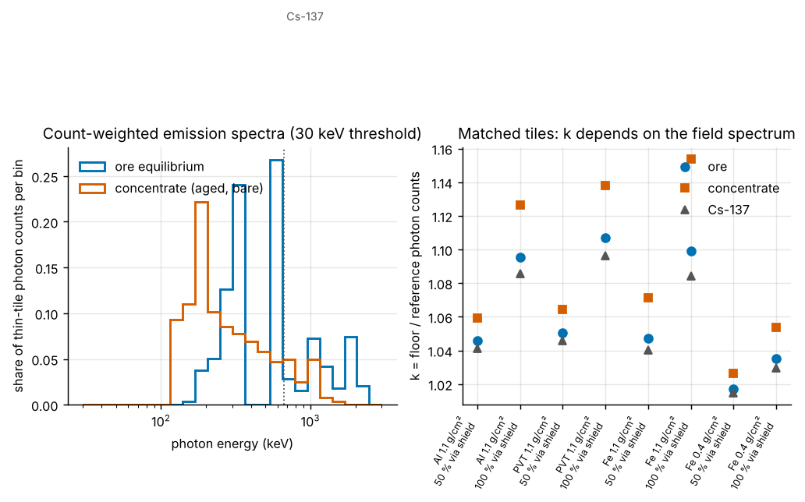
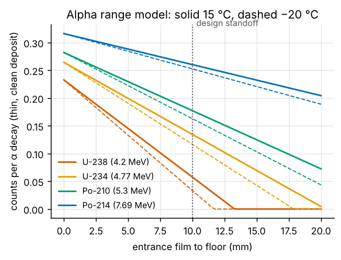
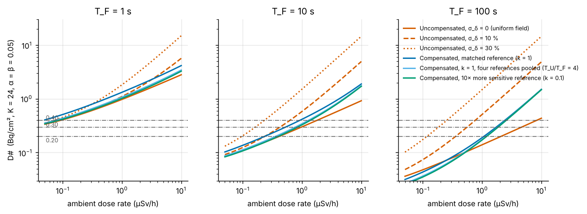
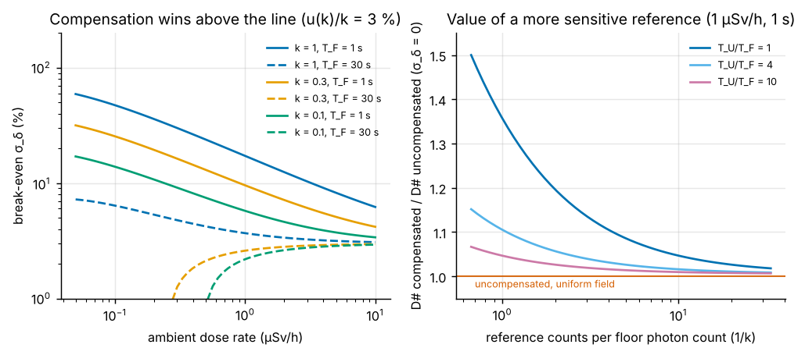
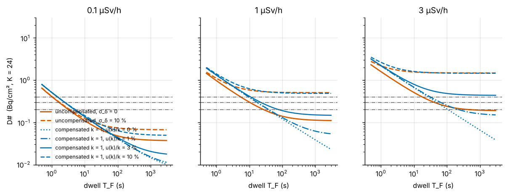
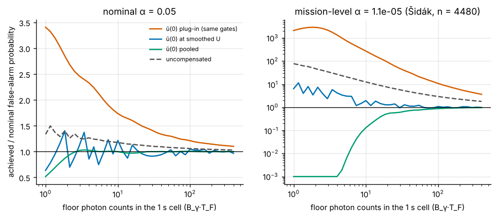
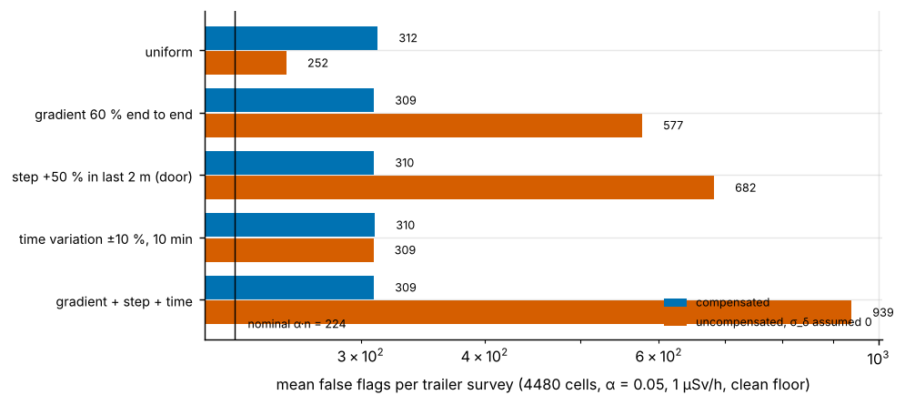
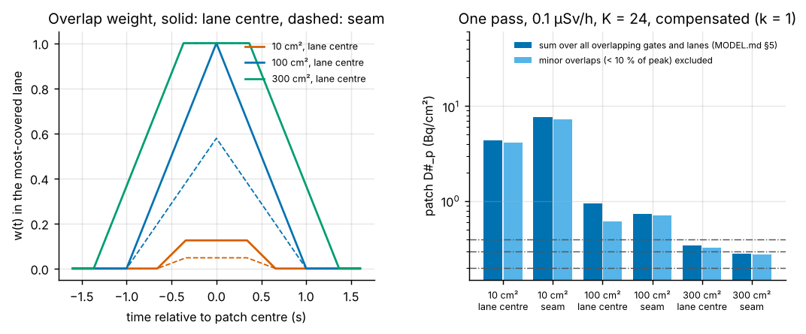
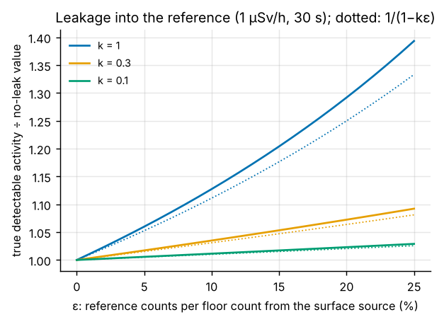

# Compensated versus uncompensated detectability at equal dwell

Rad Roomba radiometry study, design baseline 0.3. Status: **calculated, no detector exists**. Every coefficient below is an assumption with a stated range; none is a measured property of the Rad Roomba head. Model definition: `analysis/radiometry/MODEL.md` (normative, not edited here). Issues found in it are in `analysis/radiometry/MODEL_REVIEW.md`. All numbers in this report are regenerated by `./run_all.sh` from `results/`.

## 1. Answer in brief

Stated for a uniform deposit covering one 80 cm² aperture, beta-window channel, K = 24 s⁻¹ per Bq/cm² (Cl-36-equivalent, assumed), u_rel(K) = 15 %, α = β = 0.05 per decision unless noted.

1. **A single 1 s pass does not reach 0.20 Bq/cm² with either estimator**, even at natural background (0.1 µSv/h): D# = {{V:d1_unc_01}} Bq/cm² uncompensated in a perfectly uniform field and {{V:d1_comp_01}} compensated with a matched reference. Both values are above the 0.40 comparison level too. The limit is counting statistics on about four background counts per second. Reaching 0.20 in 1 s needs K ≥ {{V:Kreq_unc_01}} (uncompensated) or K ≥ {{V:Kreq_comp_01}} (compensated, matched reference). K depends by more than a factor of ten on what "1 Bq/cm²" means for ore (section 2.4), which the site has not defined.
2. **In a uniform field compensation costs sensitivity**: the matched reference raises D# by a factor {{V:penalty_matched}} at 1 µSv/h and 1 s. A reference with ten times the photon count rate (k = 0.1) reduces that penalty to {{V:penalty_ref10}}; pooling the four reference tiles reduces it to {{V:penalty_pool4}}.
3. **Compensation wins once the field is non-uniform** by more than the break-even σ_δ ≈ √(u²(k)/k² + k/(B_γ·T_U)): {{V:be_01_k1}} % at 0.1 µSv/h, {{V:be_1_k1}} % at 1 µSv/h and {{V:be_3_k1}} % at 3 µSv/h for a matched reference and 1 s; {{V:be_1_k1_T100}} % at 1 µSv/h for a 100 s recount. With a 30 % non-uniformity at 1 µSv/h the uncompensated D# for a 30 s recount is {{V:d30_unc30_1}} Bq/cm² against {{V:d30_comp_1}} compensated.
4. **u(k) sets a floor that dwell cannot remove**: D# ≥ about 2κ·B_γ·(u(k)/k)/K. With u(k)/k = 3 % it is {{V:floor_3pc_1}} Bq/cm² at 1 µSv/h and {{V:floor_3pc_3}} at 3 µSv/h. The 0.20 goal is unreachable at any dwell above {{V:hmax_3pc_K24}} µSv/h (K = 24, u(k)/k = 3 %); with u(k)/k = 1 % the bound moves to {{V:hmax_1pc_K24}} µSv/h.
5. **Dwell that reaches 0.20 Bq/cm²** (K = 24): {{V:T02_unc_01}} s uncompensated-uniform, {{V:T02_comp_01}} s compensated-matched, {{V:T02_ref10_01}} s with the 10× reference at 0.1 µSv/h; {{V:T02_comp_1}} s compensated-matched at 1 µSv/h. At 0.1 µSv/h the compensated value corresponds to a scan speed of about {{V:v02_comp_01}} m/s instead of 0.10 m/s.
6. **A per-decision α of 0.05 gives about 224 false flags per trailer** (4480 cells). A 5 % per-mission allowance needs α = {{V:alpha_sidak}} per decision, which raises the single-pass D# to {{V:d1s_comp_01}} Bq/cm² (compensated, 0.1 µSv/h). At that α the normal-quantile thresholds of MODEL.md §3 are not valid for 1 s counts (section 5.2).
7. **Small patches**: one pass over a 10 cm² patch centred on a lane has a patch detection limit of {{V:p10_lane}} Bq/cm² ({{V:p10_lane_Bq}} Bq) at 0.1 µSv/h; 100 cm² gives {{V:p100_lane}} and 300 cm² gives {{V:p300_lane}} Bq/cm². None reaches 0.20 in one pass with K = 24.
8. **The alpha channel is not a scanning channel at 10 mm standoff**: 0.20 Bq/cm² gives about {{V:alpha_counts_02}} counts per second (K_α = 6, assumed), below the three counts needed for 95 % detection with zero background. It is usable as a stationary confirmation channel if the standoff is controlled.

## 2. Parameter space and its basis

### 2.1 Assumption register

Machine-readable copy: `results/parameter_space.json`. Sources: [H7] Mirion AB-100 datasheet (docs/Sources.csv), read for this study; [NIST] X-ray mass attenuation tables for Al, Fe, vinyltoluene and air, fetched for this study; decay data are DDEP/ENSDF values transcribed from memory and not re-verified (status: unverified transcription).

{{T:assumptions}}

### 2.2 Photon emitters: ore against separated concentrate

Ore in secular equilibrium emits most of its photon energy from ²¹⁴Pb (242, 295, 352 keV) and ²¹⁴Bi (609 to 2448 keV). Chemically separated concentrate has lost ²²⁶Ra and its progeny; after ²³⁴Th and ²³⁴ᵐPa regrow (half-life 24.1 d) its photons are the 63 and 93 keV lines of ²³⁴Th, the 766 and 1001 keV lines of ²³⁴ᵐPa, the 144 to 205 keV lines of ²³⁵U, and bremsstrahlung from the 2.27 MeV ²³⁴ᵐPa beta in the uranium matrix (Kramers thick-target estimate, ±50 %). Line lists are in `results/photon_lines.csv`. The emission spectra differ strongly:

{{T:photon_fields}}

Ore emits about {{V:ore_conc_ratio}} times more photon energy per ²³⁸U decay than aged concentrate, and the concentrate spectrum is softer. In a thin-tile model (interaction probability in 0.25 mm vinyltoluene times the fraction of Compton electrons above threshold) the counts per unit air kerma are {{V:rel_ore}} (ore) and {{V:rel_conc}} (concentrate) relative to ¹³⁷Cs at a 30 keV threshold. Scattered photons, which soften real fields further, are not modelled.

The consequence for compensation: k is a ratio of two detector responses, and it changes with the spectrum whenever the floor and reference tiles see the field differently. The reference must be shielded from floor betas up to 2.27 MeV (²³⁴ᵐPa) and 3.27 MeV (²¹⁴Bi), about 1.1 g/cm² of absorber; that absorber attenuates low-energy photons arriving from below. For two identical thin tiles and that mechanism alone:

{{T:k_mismatch}}

With a 30 keV threshold the mismatch between ore-like and concentrate-like fields is 1 to 5 %. Across thresholds of 10 to 60 keV and the shield options in `results/k_spectral_mismatch.csv` it spans {{V:dk_min}} to {{V:dk_max}} %; a k fitted in a ¹³⁷Cs beam differs from the concentrate value by up to {{V:dkcs_max}} %. A low-Z shield (aluminium or the plastic light guide) keeps the mismatch smaller than steel. A thicker reference tile adds differences in wall-electron response and threshold behaviour that this model does not capture and that must be measured. The study therefore treats u(k)/k as 0 to 10 % with 3 % nominal.

### 2.3 Ambient dose rate and photon count rates

No site data exist. Natural background is about 0.05 to 0.15 µSv/h. An empty trailer at a uranium facility may stand near loaded conveyances, ore pads or mill buildings; an IAEA training figure of about 45 µSv/h per % U₃O₈ on contact with ore (search-result snippet; the document could not be opened) implies tens to hundreds of µSv/h at loaded high-grade conveyances, so 1 to a few µSv/h on a nearby empty floor is plausible. The study uses 0.05 to 5 µSv/h with 10 µSv/h as a stress case. **This range needs a site survey.**

Floor photon count rate: B_γ = S_β·Ḣ with S_β = {{V:S_beta}} s⁻¹ per µSv/h, the AB-100 ¹³⁷Cs beta-channel value (42 for 101 cm²) scaled to 80 cm². A fluence check supports the order of magnitude: 1 µSv/h of 662 keV photons is about 82 cm⁻² s⁻¹, and 0.25 mm of plastic interacts with 0.22 % of them, giving about 18 s⁻¹ per 100 cm² before wall electrons. The range 15 to 90 covers spectrum, housing and threshold.

{{T:background_rates}}

The reference rate is U = B_γ/k. A matched tile gives k ≈ 1. Photon interactions in thin plastic scale nearly linearly with thickness (NIST µ), so a reference tile several millimetres thick gives k of 0.1 to 0.3.

### 2.4 Surface response K of the beta window

K = (counts per decay) × 80 cm² × geometry. Counts per decay are read across from AB-100 contact responses by beta end-point energy. The dominant uncertainty is not the detector but the measurand: the same deposit has a K that differs by more than ten times depending on which activity "1 Bq/cm²" counts.

{{T:K_beta_basis}}

Geometry: for isotropic emission without absorption, a source the size of the aperture at 10 mm delivers {{V:geom10}} of its 2π emission to the aperture, against {{V:geom3}} at 3 mm (ratio {{V:geom_ratio}}); a source much wider than the aperture loses nothing. Radon loss from thin dust and self-absorption lower the ore values: with 30 % radon loss the per-²³⁸U value for the aperture-size geometry falls to about {{V:K_ore_lo}}. Fresh concentrate has almost no beta emission until ²³⁴Th/²³⁴ᵐPa regrow. The study uses K = 8, 13, 24, 50 and 100; D# is exactly proportional to 1/K at fixed u_rel(K), so every D# below can be rescaled by 24/K.

### 2.5 Is the alpha channel viable at 10 mm?

A range model (air range 1.24E − 2.62 cm for 4 to 8 MeV, window 0.84 mg/cm² ≈ 7 mm air-equivalent, 1 MeV residual-energy threshold, scaled by {{V:alpha_derate}} to reproduce the AB-100 ²³⁹Pu efficiency) gives counts per alpha decay for a thin, clean deposit:

{{T:alpha_efficiency}}

The 4.2 MeV alpha of ²³⁸U has a 2.6 cm range, of which the gap and window consume 1.7 cm at normal incidence. For thin natural uranium the efficiency is about {{V:eff_unat_10}} % at 10 mm ({{V:eff_unat_3}} % at 3 mm), K_α ≈ {{V:K_alpha_unat10}} s⁻¹ per Bq/cm². It falls by {{V:alpha_drop_2mm}} % if the gap opens to 12 mm and by {{V:alpha_drop_cold}} % at −20 °C because the air is denser. Dust loading, ore grains and rough floors degrade the alpha spectrum further; this is not modelled. Implications: (i) K_α carries a relative uncertainty of at least 30 %, and the detection limit is undefined once κ·u_rel(K) ≥ 1 (u_rel ≥ 61 %); (ii) the standoff must be measured during the survey, not assumed, if alpha results are to be quantitative; (iii) the scan decision has to rest on the beta window.

## 3. Equations and their implementation

| MODEL.md | Quantity | Function in `rrrad` |
|---|---|---|
| §2 | r = F − k·U − b; u²(r) counting and transfer terms; D, u(D) | `model.net_rate`, `u2_counting`, `u2_transfer`, `estimate` |
| §3 | ũ²(0), r\*, r#, D\*, D# (closed form for α = β and for α ≠ β; Brent solve) | `model.u0sq_comp`, `decision_threshold`, `detection_limit_rate`, `detection_limit_activity`, `*_numeric` |
| §3 | Šidák per-decision α | `model.sidak_alpha` |
| §4 | Uncompensated ũ²(0) | `model.u0sq_unc`, `unc_limits` |
| §5 | Gate integral of w(t), summed T_S and W_S, patch limit | `patch.gate_weights`, `patch_sum`, `patch_dhash` |
| — | Exact Poisson error probabilities | `exact.comp_flag_probability`, `unc_flag_probability` |
| — | Leakage ε | `model.leak_detection_limit_rate` |

With B_γ = k·U the compensated null variance is ũ²(0) = (B_γ + b)/T_F + k·B_γ/T_U + B_γ²·(u(k)/k)² + u²(b) + 2U·cov(k,b). The uncompensated one is B/T_F + B₀/T₀ + σ_δ²B². The two have the same structure: the reference replaces the field term σ_δ²B² by B_γ²(u(k)/k)² and the background-count term B₀/T₀ by k·B_γ/T_U. u(k) is applied to the whole reference rate with cov(k,b) = 0, which is exact for a spectral mismatch and conservative for a pure fit uncertainty near the centre of the fitted range.

## 4. Analytic comparison at equal dwell

Nominal case: S_β = {{V:S_beta}} s⁻¹ per µSv/h, b = 0.5 s⁻¹, u(b) = 0.05 s⁻¹, u(k)/k = 3 %, T₀ = 60 s, K = 24, u_rel(K) = 15 % (which multiplies every D# by {{V:urelK_factor}}). Full grids: `results/analytic_comp_grid.csv`, `results/analytic_unc_grid.csv`.

### 4.1 D# by field, dwell and estimator

{{T:headline}}

### 4.2 Regimes

**Where compensation loses.** In a uniform, low field the reference adds the counting variance k·B_γ/T_U and nothing else changes. For a matched tile and equal live time the null variance doubles, the classical paired-blank result, and D# rises by up to √2. This penalty shrinks in proportion to k·T_F/T_U: a reference with more photon counts per floor photon count, or reference counts pooled over the four lanes or over a longer window, recovers most of it. Pooling assumes the field is uniform over the pooled extent.

**Break-even.** Compensation has the lower D# when σ_δ exceeds the value below (u(k)/k = 3 %, T_U = T_F; "always wins" means the 60 s background count of the uncompensated procedure already costs more than the reference).

{{T:breakeven}}

**Floor from u(k).** As T_F and T_U grow, ũ(0) tends to B_γ·u(k)/k and D# to 2κ·B_γ·(u(k)/k)/(K(1 − κ²u_rel²(K))). A spectral mismatch is a fixed bias inside one site, so no dwell, averaging or number of passes reduces it.

{{T:floor}}

The uncompensated estimator has the same kind of floor, 2κ·σ_δ·B/K, with σ_δ in place of u(k)/k. Compensation is worth having exactly when u(k)/k can be made smaller than σ_δ.

### 4.3 Against 0.20, 0.30 and 0.40 Bq/cm²

Cells are "D# at α = 0.05 / D# at the mission-level α = {{V:alpha_sidak}}" in Bq/cm² for K = 24.

One pass (T_F = 1 s):

{{T:single_pass}}

Two passes summed (T_F = 2 s) are tabulated in `results/headline_dhash.csv`. With K = 24 neither one nor two passes reach 0.20 at 0.1 µSv/h or above, with either estimator; at 0.1 µSv/h two uncompensated passes in a uniform field give {{V:d2_unc_01}} and two compensated passes {{V:d2_comp_01}}. The single-pass compensated value at 0.1 µSv/h is {{V:d1_K8_comp_01}} for K = 8, {{V:d1_K50_comp_01}} for K = 50 and {{V:d1_K100_comp_01}} for K = 100. Only the upper end of the K range (ore, activity expressed per Bq of ²³⁸U with the chain in equilibrium) meets 0.20 in one pass, and only up to about 0.3 µSv/h.

Dwell needed for D# ≤ 0.20 (α = β = 0.05; other levels and the mission-level α are in `results/dwell_required.csv`):

{{T:dwell}}

For the compensated, matched estimator with K = 24 the dwell for 0.30 and 0.40 Bq/cm² is {{V:T03_comp_01}} s and {{V:T04_comp_01}} s at 0.1 µSv/h, and {{V:T03_comp_1}} s and {{V:T04_comp_1}} s at 1 µSv/h.

K needed for D# ≤ 0.20 in one pass (two passes in `results/K_required.csv`):

{{T:K_required}}

Options that would bring a moving scan to 0.20 for K ≈ 24, in order of leverage: (a) slow the scan or lengthen the aperture along travel so that the dwell is about 4 to 5 s at natural background; (b) a more sensitive or pooled reference to remove the counting penalty; (c) lower the floor tile's photon response (thinner plastic, higher threshold) at constant beta efficiency, since D# ∝ √B; (d) a scan-then-recount rule (section 4.4). None helps above the dose rate at which the u(k) floor exceeds the goal.

### 4.4 Mission-level false alarms and a scan-plus-recount rule

A trailer of 2.5 m × 16 m holds {{V:n_cells}} cells of one aperture by 0.1 m. At α = 0.05 per decision the expected number of false flags is 224. The Šidák value for a 5 % chance of any false investigation per mission is α = {{V:alpha_sidak}} (κ = {{V:kappa_sidak}}).

A two-stage rule spends the allowance more efficiently: scan at a looser α₁, then recount each flagged cell stationary for 30 s at α₂ = (mission α)/α₁, with β = 0.025 at each stage. The overall detection limit is the larger of the two stage limits:

{{T:two_stage}}

The recount stage is much more sensitive than the scan stage, so the scan stage sets the overall limit, and accepting more recounts buys only a modest improvement. A recount rule therefore controls false investigations cheaply but does not by itself deliver 0.20 Bq/cm²; the scan dwell or K has to change.

### 4.5 Alpha channel

Compensated alpha-channel D# for the assumed K_α range, with k_α = {{V:k_alpha}} (alpha-channel photon counts per reference count) and u_rel(K_α) = 35 %, which multiplies D# by {{V:urelK_alpha_factor}}:

{{T:alpha_channel}}

The alpha background is so low that the reference contributes almost nothing; the limit is the κ²/T_F term, that is, the need for a few counts. At 1 s the nominal value is {{V:alpha_d1}} Bq/cm²; a 10 s stationary count gives {{V:alpha_d10}}. At these count levels the normal approximation is itself poor (2.71 counts where the Poisson requirement is 3.0).

## 5. Monte Carlo and exact-Poisson validation

Truth and rule are separated: the truth has a transfer coefficient k(1 + m) with a spectral mismatch m ~ N(0, 3 %) and Poisson counts; the rule uses an estimate k̂ with a 1 % fit error and declares u(k)/k = √(1² + 3²) %. Each calibration error is drawn once per simulated calibration. Seeds are fixed.

### 5.1 Achieved error probabilities at α = β = 0.05

{{V:n_trials}} trials per point; full grid of four dose rates and five dwell times in `results/mc_point_validation.csv`.

{{T:mc_points}}

Findings over the full grid:

- With ũ(0) evaluated at the true (or independently smoothed) reference rate, the compensated rule achieves false-alarm probabilities of {{V:mc_true_fa_min}} to {{V:mc_true_fa_max}} and detection probabilities at the analytic r# of {{V:mc_true_pd_min}} to {{V:mc_true_pd_max}}. The analytic model is confirmed, including the calibration terms; the residual deviations occur at about four counts per cell and come from the integer counts.
- With ũ(0) evaluated at the reference rate of the same gates (the literal reading of MODEL.md §3) the false-alarm probability is {{V:mc_plug_fa_min}} to {{V:mc_plug_fa_max}}: a low reference count lowers the threshold and raises r at the same time.
- The uncompensated rule with σ_δ declared achieves {{V:mc_unc_fa_min}} to {{V:mc_unc_fa_max}} and {{V:mc_unc_pd_min}} to {{V:mc_unc_pd_max}}. If a real 20 % non-uniformity is not declared, its false-alarm probability rises to tens of per cent and grows with dwell.

### 5.2 Mission-level α: the normal quantiles fail at low counts

Exact Poisson sums, no calibration uncertainty, matched reference. Columns 3 to 6 are achieved ÷ nominal false-alarm probability at α = {{V:alpha_sidak}}; the last two compare the exactly computed detectable rate (threshold recalibrated to hold α) with the formula.

{{T:exact_mission}}

At 0.1 µSv/h and 1 s the literal plug-in rule exceeds the nominal α by a factor {{V:ex_plug_01_1}}, about {{V:ex_flags_plug_01_1}} false flags per trailer where 0.05 were intended. Evaluating ũ(0) at a smoothed reference rate removes most of this (factor {{V:ex_true_01_1}}); the remainder, and the factor {{V:ex_unc_01_1}} of the uncompensated rule, is the Poisson tail being heavier than the normal tail. A pooled null estimate holds α but loses power at small α: its detection probability at the formula r# is {{V:ex_pooled_pd_01_1}} at 0.1 µSv/h and 1 s, where 0.95 is intended. Once the threshold is recalibrated to hold α, the exactly computed r# exceeds the formula by a factor of {{V:ex_ratio_c_min}} to {{V:ex_ratio_c_max}} (compensated) and {{V:ex_ratio_u_min}} to {{V:ex_ratio_u_max}} (uncompensated): the D# values of section 4 at the mission-level α are optimistic by up to that factor.

### 5.3 False flags per trailer in structured fields

{{V:n_surveys}} simulated surveys of a clean floor per row, {{V:n_cells}} cells each, serpentine path at 0.10 m/s, 1 µSv/h at the reference position (0.3 µSv/h in `results/mc_survey_flags.csv`). "σ_δ equiv." is the rms relative deviation of the field from its value where B₀ was measured (trailer centre, 60 s).

{{T:survey_flags}}

- The compensated count does not depend on the field structure: about {{V:sv_uni_comp_true}} at α = 0.05 with the smoothed threshold in every scenario ({{V:sv_uni_comp}} with the plug-in threshold).
- The uncompensated count with σ_δ assumed zero rises from {{V:sv_uni_unc}} (uniform) to {{V:sv_grad_unc}} (gradient) and {{V:sv_all_unc}} (gradient, door step and time variation). Declaring σ_δ approximately restores the mean for a smooth gradient ({{V:sv_grad_unc_decl}}) at the cost of the much larger D# of section 4, but not for a step: a Gaussian σ_δ does not describe a field in which one region is 50 % higher, and the flags concentrate there.
- At the mission-level α the compensated rule gives P(≥1 false flag) = {{V:sv_sidak_comp_p1}} in the uniform field and {{V:sv_sidak_comp_p1_all}} in the combined field, close to the 0.05 allowance. The uncompensated rule gives {{V:sv_sidak_unc_p1}} and {{V:sv_sidak_unc_p1_all}}. At 0.3 µSv/h the same uniform-field values are {{V:sv_sidak_comp_p1_03}} and {{V:sv_sidak_unc_p1_03}}, the excess being the Poisson-tail effect of section 5.2.
- The 95th percentile of the flag count is well above the mean in every row: the calibration error is common to all cells of a survey, so false flags arrive in clusters. Šidák's formula assumes independent decisions.

### 5.4 Moving patch

Square patches crossing at 0.10 m/s with 100 ms gates, 0.1 µSv/h, K = 24, compensated with a matched reference; {{V:n_patch_trials}} gate-level trials per case. T_S is the summed live time of all gates and lanes whose apertures overlap the patch (MODEL.md §5), W_S = Σ∫w dt, and the patch limit is D#(T_S)·T_S/W_S.

{{T:patch}}

- The Monte Carlo reproduces α and 1 − β at the analytic patch limit for both estimators and both gate phases.
- A patch smaller than the aperture is diluted by A_p/A_a: one pass over 10 cm² integrates W_S = 0.125 s against 1.4 to 1.5 s of background. A 10 cm² patch at 0.30 Bq/cm² (3 Bq) yields about one count; the limit is {{V:p10_lane}} Bq/cm².
- On a seam a 10 cm² patch loses the 7.5 mm gap between apertures and splits over two lanes ({{V:p10_seam}} Bq/cm²). A second pass offset by half a pitch places it on a lane centre.
- Gate phase changes T_S by one gate (14 or 15 gates for 10 cm²) and D#_p by about 3 %. With fixed 1 s map cells the detection probability at the same activity varies with the alignment of the cell grid as shown; that rule makes several decisions per patch, so its false-alarm probability is correspondingly higher.
- Summing every lane with any overlap is costly for a 100 cm² patch centred on a lane: it touches both neighbours by 2.5 mm, which triples the summed background for 6 % more signal ({{V:p100_lane}} against {{V:p100_lane_excl}} Bq/cm² when overlaps below 10 % of the peak are excluded).
- The top-hat response ignores the blur of roughly one standoff at the aperture edges (section 2.4).

## 6. Leakage of surface signal into the reference

If a fraction ε of the floor net rate ρ from a surface source also appears in the reference, then E[r] = ρ(1 − kε): the subtraction removes kε of the true signal. The reference variance and the threshold rise slightly as well.

{{T:leakage}}

The loss is governed by the product kε, so a more sensitive reference (small k) is also less exposed to leakage per count. A Monte Carlo check at k = 1, ε = 10 %, 1 µSv/h and 30 s gives a detection probability of {{V:leak_pd}} at the leak-corrected limit and {{V:leak_pd_naive}} at the limit computed without leakage.

Effect on calibration. k and b are fitted on photon-only data and do not contain ε. K does: calibrated with compensation enabled, K absorbs the factor (1 − k·ε_cal), and the reported activity is unbiased only for emitters with the same ε as the calibration source. Betas of ²³⁴ᵐPa and ²¹⁴Bi penetrate a shield more than those of a ³⁶Cl source:

{{T:leakage_cal}}

The test that measures ε: in a constant photon field, record F and U with and without a representative surface source under the floor aperture, with the full stack in place; ε = (U_on − U_off)/(F_on − F_off). Repeat for source energies spanning ³⁶Cl to ⁹⁰Y (or a uranium-series source) and for each candidate shield. Count times for a standard uncertainty of 0.005 in ε:

{{T:leakage_test}}

## 7. Conclusions

Each statement holds under the stated condition and for the assumed parameter ranges only.

1. If K is about 24 s⁻¹ per Bq/cm² (Cl-36-equivalent calibration), then a 1 s pass cannot demonstrate D# < 0.20 Bq/cm² at any dose rate studied, compensated or not, and at 0.1 µSv/h or above it cannot demonstrate D# < 0.40 either. If the site defines activity so that K is near 100, then one pass reaches about {{V:d1_K100_comp_01}} Bq/cm² at 0.1 µSv/h and {{V:d1_K100_comp_1}} at 1 µSv/h.
2. If the photon field is uniform to better than the break-even σ_δ, the uncompensated estimator has the lower D#, by up to √2 against a matched reference. If the field varies by more than that, the compensated estimator has the lower D#, and it keeps its false-alarm rate in gradients, steps and time variation where the uncompensated one does not.
3. If the reference delivers ten times the photon counts of the floor tile, or the four references are pooled, then compensation costs a factor {{V:penalty_ref10}} to {{V:penalty_pool4}} in D# instead of {{V:penalty_matched}} (1 µSv/h, 1 s), provided the more sensitive reference does not bring a larger spectral mismatch.
4. If u(k)/k is 3 %, the 0.20 goal cannot be met above about {{V:hmax_3pc_K24}} µSv/h for K = 24 ({{V:hmax_3pc_K100}} µSv/h for K = 100) at any dwell. The calibration validity envelope must cap the reference rate accordingly.
5. If the per-mission false-investigation allowance is 5 % and decisions are made per 1 s cell, then thresholds must come from Poisson statistics with ũ(0) evaluated at a smoothed reference rate; the normal-quantile rule of MODEL.md §3 evaluated on the same gates exceeds the allowance by orders of magnitude at natural background.
6. If the site's smallest patch is 10 cm², a moving scan at 0.10 m/s detects it only at several Bq/cm²; if it is 300 cm², the single-pass patch limit is about {{V:p300_lane}} Bq/cm² at natural background with K = 24.
7. If alpha results are required, they need stationary dwell of at least 10 s and a measured standoff; at 10 mm the alpha response to ²³⁸U changes by tens of per cent for 2 mm of gap or a 35 K change in air temperature.
8. If a fraction ε of surface signal reaches the reference, true signal is suppressed by kε; with a matched reference ε must be known to about 1 % absolute for a 1 % activity bias.

### 7.1 MODEL.md revision 3 (section 6, IB-31): weighted sums and the multi-lane cell rule

Full numbers in [`model_rev3_checks.md`](model_rev3_checks.md); verdicts and proposed wording in `../MODEL_REVIEW_rev3.md`. All values `calculated` (exact lattice convolution) or `simulated`, with synthetic coefficients.

- Weighted sums, `poisson-exact`: **not conservative**. Achieved ÷ nominal false-alarm probability up to {{V:rev3_A_scan_max}} in the beta window with U_null exact ({{V:rev3_A_scan_case}}) and {{V:rev3_alpha_max}} in the alpha channel ({{V:rev3_alpha_case}}). Realistic footprint weights in the beta window are conservative, at a sensitivity cost of {{V:rev3_A_loss_real_min}}–{{V:rev3_A_loss_real_max}} in r#.
- The 20·T_F U_null window of section 3 by itself gives up to {{V:rev3_win20_01_1}} × nominal at mission-level α (0.1 µSv/h, 1 s, all weights 1); 200·T_F gives {{V:rev3_win200_01_1}}. The pooled same-gate fallback gives up to {{V:rev3_B_pooled_max}} per lane.
- Any lane at α/m: the union bound holds when each lane holds α/m; the quoted min D#ᵢ holds only for activity extending beyond the cell (P(detect) at the quoted limit {{V:rev3_B_pcell_min}}–{{V:rev3_B_pcell_max}} for activity confined to the cell), and maxᵢ D#ᵢ is not a seam-patch limit (P {{V:rev3_B_pseam_min}}–{{V:rev3_B_pseam_max}}). Cost against an exact combined statistic up to {{V:rev3_B_cost_m4}} (m = 4).
- One exact linear statistic over all lanes (Gil-Pelaez inversion, validated to {{V:rev3_C_gp_err}} relative tail error against exact convolution) gives a median D# of {{V:rev3_s01_C}} Bq/cm² on the s01-like plan, against {{V:rev3_s01_rev3}} for revision 3 and {{V:rev3_s01_rev2}} for revision 2.

### 7.2 The null reference U_null (MODEL.md revision 4, §3)

Numbers in [`model_rev4_unull.md`](model_rev4_unull.md); verdict and proposed wording in `../MODEL_REVIEW_rev4.md`. `calculated` with synthetic coefficients.

- What the threshold needs from U_null is a number of reference counts, not a multiple of T_F. With the plug-in threshold, holding ≤ 1.05 × nominal at mission α takes up to {{V:rev4_plug_scan_mis_05}} counts (scan) and {{V:rev4_plug_rec_mis_05}} (recounts). With a predictive threshold (null distribution averaged over the posterior of U given the window), it takes ≤ {{V:rev4_pred_scan_mis_05}} and ≤ {{V:rev4_pred_rec_mis_05}}, at a D# cost ≤ {{V:rev4_cost_100_max}} at 100 counts.
- Taking the larger of the past and future half-window means keeps steps and gradients from biasing U_null low (worst {{V:rev4_grad_max_halves}} × nominal at mission α). A centred mean gives up to {{V:rev4_grad_centred_max}} × at a step; a past-only mean up to {{V:rev4_grad_past_max}} ×.
- Stationary recounts need no bracketing time when the other three lanes' references during the count are used, ratio-scaled. A pooled window needs that scaling too: a 1 % lane-ratio error gives {{V:rev4_pool_m1_mis}} × at mission α.

## 8. Measurements that replace the assumptions

| Assumption | Measurement that replaces it | Design choice it drives |
|---|---|---|
| Meaning of 1 Bq/cm², patch size, α, β, mission allowance | Site RP decision (not a measurement) | Everything: K, dwell, speed, recount rule |
| K_β and u_rel(K_β) | Traceable planar sources (³⁶Cl, ⁹⁰Sr/⁹⁰Y, natural U) at the loaded 10 mm gap, source wider than and equal to the aperture, representative floor finishes | Scan speed, aperture length, number of passes |
| S_β, b (floor photon response and offset) | Floor and reference rates in photon-only fields against a dose-rate meter, ¹³⁷Cs plus ore-like and concentrate-like sources | Floor tile thickness and threshold; background count B |
| k, u(k), cov(k,b) and spectral mismatch | Clean-floor F against U over the intended rate range in at least two spectra and several directions; held-out validation | Reference tile thickness, shield material, validity envelope (maximum reference rate) |
| Reference count rate per floor photon count (1/k) | Same data with candidate reference tiles (0.25, 2, 5 mm) | Reference tile size and thickness; whether to pool lanes |
| σ_δ and time variation of the field | Dose-rate or reference-rate map along representative empty trailers at the site | Whether compensation is needed at all; reference averaging length |
| Ambient dose-rate range | Site survey at loading and survey positions | Validity envelope; whether 0.20 is attainable on site |
| ε (leakage) by beta energy | F and U with and without surface sources, per shield option (section 6) | Shield material and thickness; K basis |
| K_α and its standoff and temperature dependence | Thin ²³⁸U/natural-U and ²⁴¹Am sources at 6 to 14 mm, at +20 and −20 °C | Whether an alpha map is reported; standoff tolerance; recount dwell |
| Spatial response of the aperture, seam loss | Raster of small sources across face, corners and seam at the working gap | Lane pitch, pass offset, minimum patch claim |
| Achieved α and β at low counts; Cov(F,U) | Long clean-floor runs at gate level; moving-source passes | Threshold rule (Poisson), recount rule, α₁ of the scan |
| Dead time and gate timing | Rate sweep, pulser | Upper rate limit of the envelope |

## 9. Limits of this study

- No detector data. The AB-100 is a different instrument; its numbers set orders of magnitude only.
- Photon spectra are emission spectra of the principal lines; scatter, build-up, self-absorption in the source and angular distribution are not modelled. The spectral dependence of k covers shield attenuation only.
- Decay data were transcribed from memory and not re-verified. The dose-rate basis rests on a search-result snippet.
- The alpha model is a straight-track range calculation for thin deposits.
- Dead time, Cov(F,U), pose error, standoff variation during motion and non-Poisson noise (heater or motor interference) are not included.
- Uniform aperture response is assumed, as MODEL.md §5 prescribes until a measured response exists.
- "Smoothed" thresholds are represented by evaluating ũ(0) at the true reference rate. A finite smoothing window, and the bias it picks up where the field changes within the window, were not simulated.
- Thresholds that hold the mission-level α exactly were computed only without calibration uncertainty (section 5.2).
