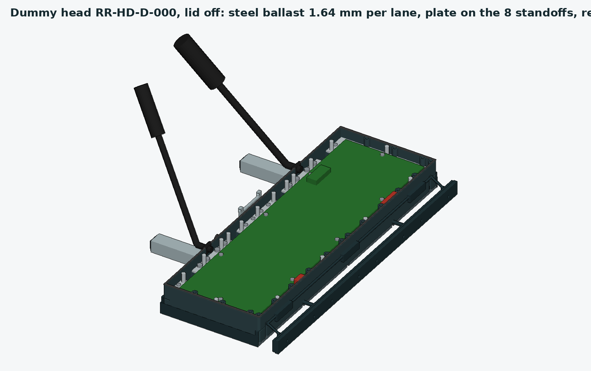
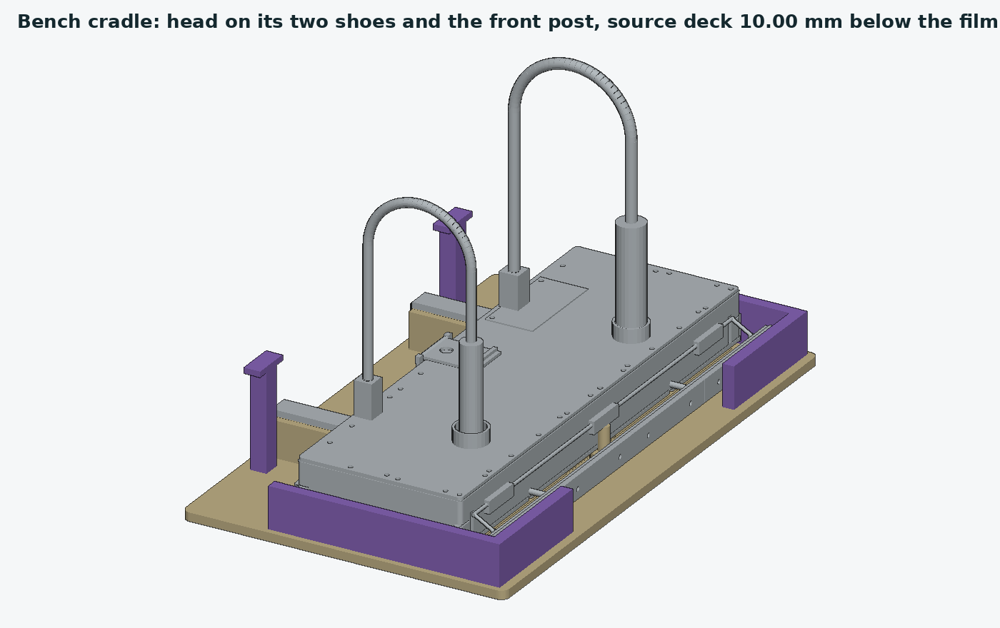

# Dummy head, bench cradle and gap gauges

Generated by `mechanical/head/docs.py`. STEP: `aux/RR-HD-D-000_dummy_head_assembly.step`, `aux/RR-HD-C-600_bench_cradle_with_head.step`, parts in `aux/step/`.

## Dummy head RR-HD-D-000 (BOM W34)

- Same printed frame halves, shoes, bridge, keeper, rails, switches, lid and cassettes as the prototype (identical receiver: shoes, x-stop shoulders, latch keeper,
  flat left shoe tip that actuates HEAD_DOCK). No optics, no board, no fences.
- Mass / CG: steel ballast plate 1.64 mm per lane on the module seat (RR-HD-D-301) + printed spacer (RR-HD-D-302) that the standard pad clamps;
  aluminium plate RR-HD-D-501 on the eight board standoffs. Calculated: 1846 g vs prototype 1846 g, CG offset within the
  check limits (head_report.md, check "dummy head mass and CG"). Re-solve the ballast thickness from the measured mass of the real modules (checks.py does it).
- Electrical: resistor block RR-HD-D-502 on the plate: HEAD_LOOP through the three real rail switches + 1.00 kOhm 1 % (J1 5/6), PRES_ID 4.70 kOhm 1 % pin 7 to 2,
  J2 pin 7 linked to pin 4 in the plug; same J1 / J2 pigtails and glands as the head. It therefore exercises dock, latch, loop and presence logic without optics.
- The five 8 mm holes per lane in ballast and spacer (centre and +-40 / +-30 mm) are the mounting positions for the gap followers of
  `mechanical/common/out/gap_measurement_method.md` (follower hardware belongs to the measurement equipment, not modelled here).

## Bench cradle RR-HD-C-600

- Deck RR-HD-C-601: 6 mm cast tooling plate; its top face is the "floor" (z 0). Two shoe saddles with 8 mm lands at x 8 and 62 at z 16.00 (datum C),
  side guides (datum B) and x-stop faces at x 65.7 (datum A), as the body receiver; front post pad at z 23.20 under the centre bail block as third support.
  The head therefore sits with its film plane at 10.00 mm above the deck (tolerance stack: head_report.md section 7).
- Four 50.6 x 3.2 pockets at the lane centres take a 50.8 mm check source flush with the deck top -> **10.00 mm source-to-film**, repeatable to the
  head's own stack (+-0.27 RSS prototype). The source slide RR-HD-C-609 gives a 7.0 mm position.
- Fences keep hands off the window zone and carry the slide stop; cable rests hold the pigtails and plugs off the bench. The films never touch the cradle.

## Gap gauges RR-HD-G-70x

10.00 mm setting block (followers zeroed at the film plane), stepped go/no-go wedges 4..10 and 10..16 mm in 0.5 mm steps, 1.5 / 3 / 5 mm ground shims
(floor-feature simulation), all per gap_measurement_method.md section 2.
