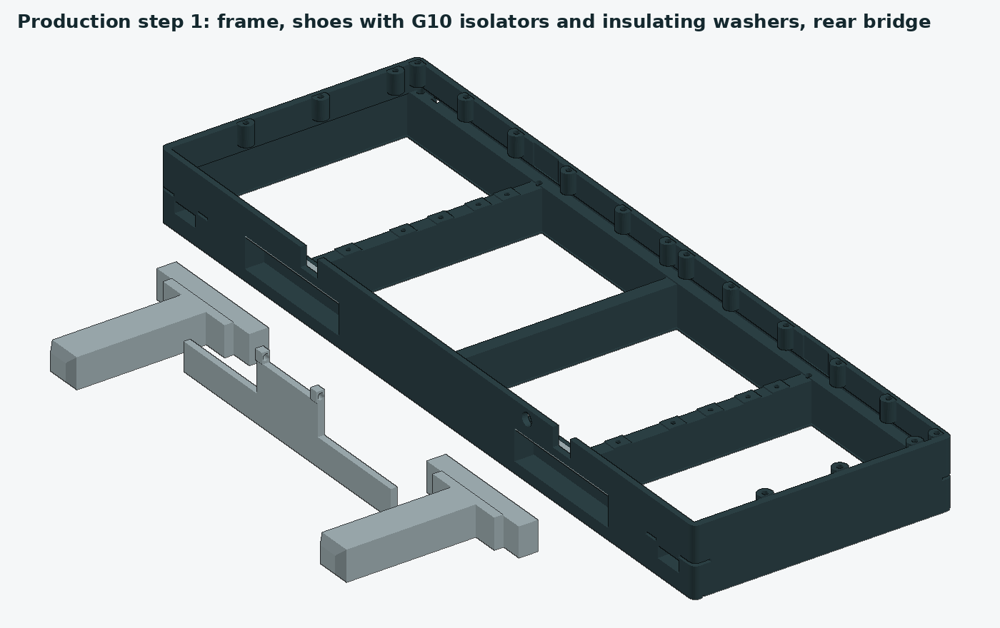
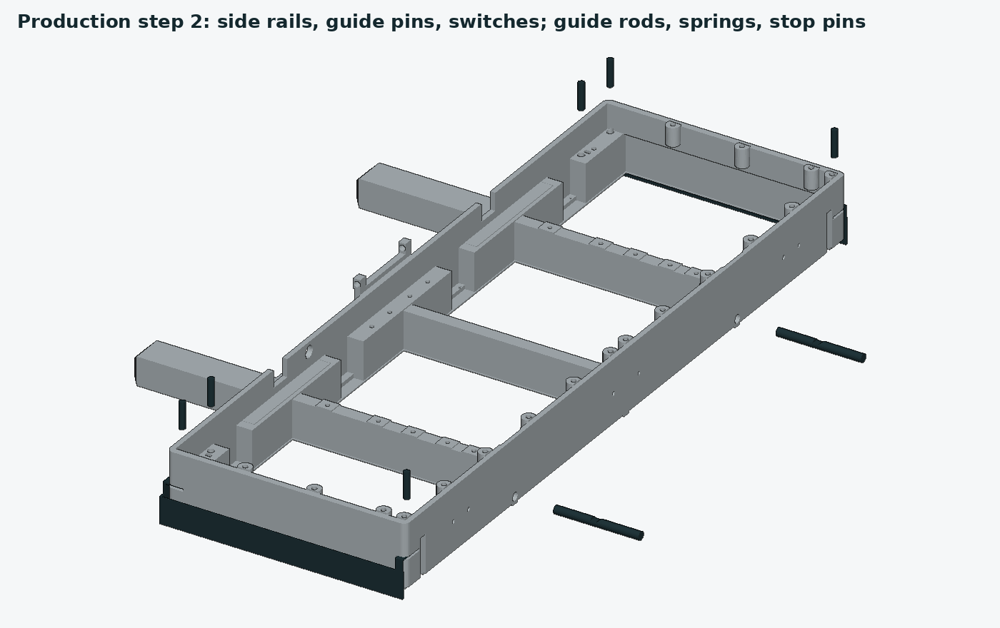
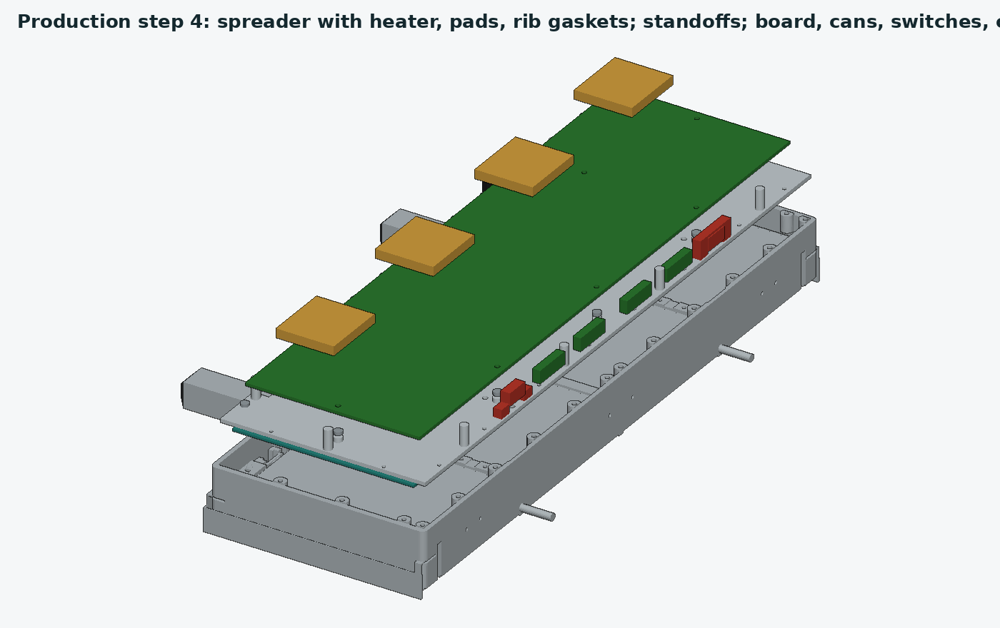

# Assembly -- production head RR-HD-P-000 (CNC 6061 frame)

Generated by `mechanical/head/docs.py`; images from `drawings.py steps_production` (`production/assembly/`). Parts: `production/bom_production.csv`.
Mass 2082 g, CG (120.0, -0.1, 32.9) mm (calculated). Same sequence as the prototype (`prototype/assembly.md`) with these differences:
one-piece frame (no dowels, no tongue), no EMI fences (the black-anodised frame with masked bond lands is the enclosure), tapped threads instead of
inserts; the shoes are isolated from the frame exactly as in the prototype (G10 isolators, insulating washers, anodised shoes and pockets, R2801 fitted); MJF PA12 lane parts, POM rail inserts and bail blocks, moulded silicone grommets, conductive lid gasket.

## Torques

| Joint | Prototype | Production |
|---|---|---|
| M2.5 into heat-set insert (printed) | 0.35 N m | 0.45 N m into tapped 6061 |
| M3 into heat-set insert (printed lid bosses) | 0.5 N m | 0.9 N m into tapped 6061 |
| M3 lid screw into aluminium standoff | 0.6 N m | 0.6 N m |
| M3 low-head into the T-head (aluminium) | 0.9 N m | 0.9 N m |
| M4 bridge to T-head ears | 2.0 N m | 2.0 N m |
| M2.5 board screws | 0.35 N m | 0.35 N m |
| cassette M2.5 CSK | 0.3 N m | 0.45 N m |

## Sequence

1.  Frame on the fixture (shoe datums A/B/C); shoes with G10 isolators, rear bridge (M4 2.0 N m); megger check FRAME to shoes >= 10 Mohm.
2.  Side rails, guide pins, side switches (preset 0.40 mm), rods, springs, stop pins.
3.  Lane kits from above; stack-height check.
4.  Spreader (heater, pads, rib gaskets bonded), standoffs (11 mm), board, cans, switches, grommets, desiccant, cut-out, NTC.
5.  Lid with conductive gasket, 34 x M3 + bonded washers (18 into tapped frame bosses), blister, polyimide tape, keeper; insulating jacket cap RR-HD-S-131 (PSA on the lid, screws reachable through its holes) and front band RR-HD-S-132 (standard cold configuration).
6.  Cassettes (CNC 6061, black anodise) and leading rail.

Overview: 

End-of-line tests: `production/README.md` section 6.
