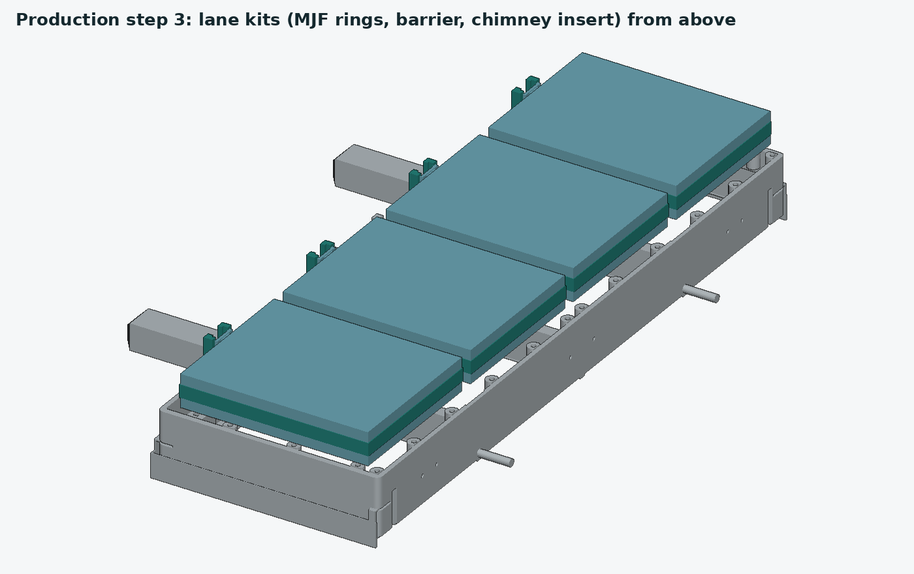
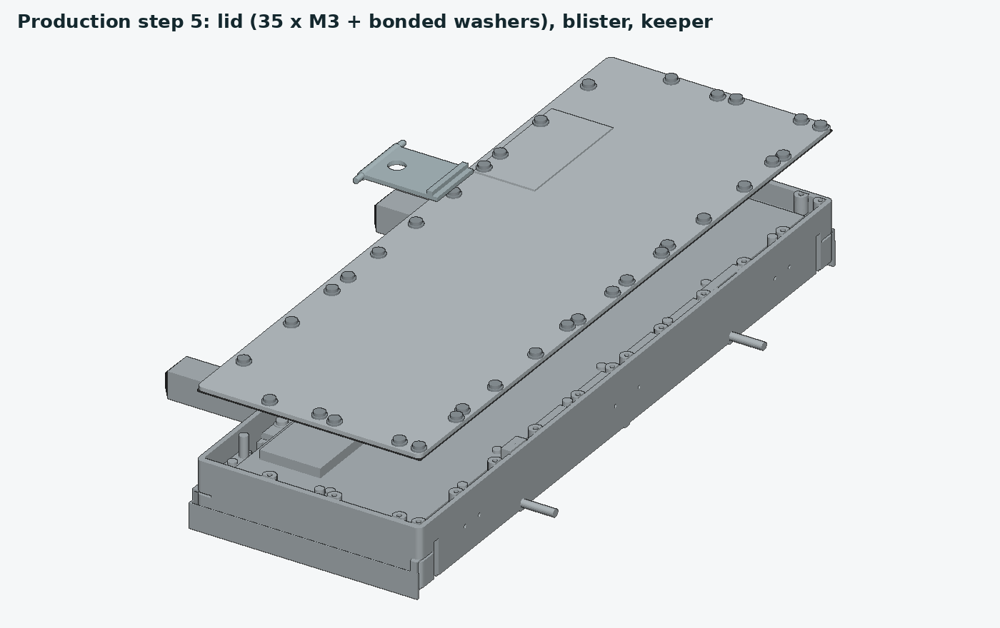
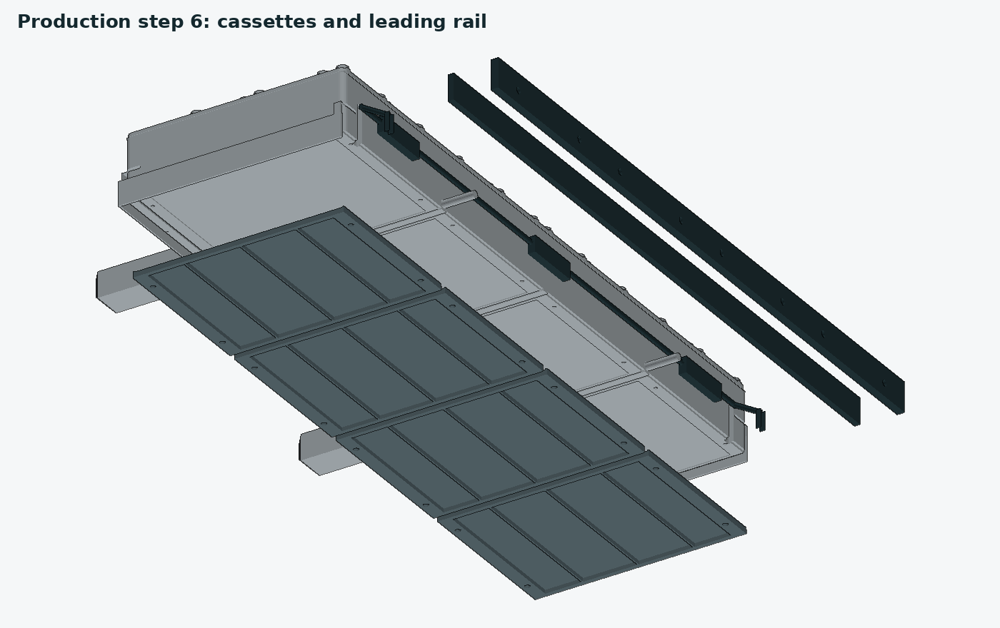
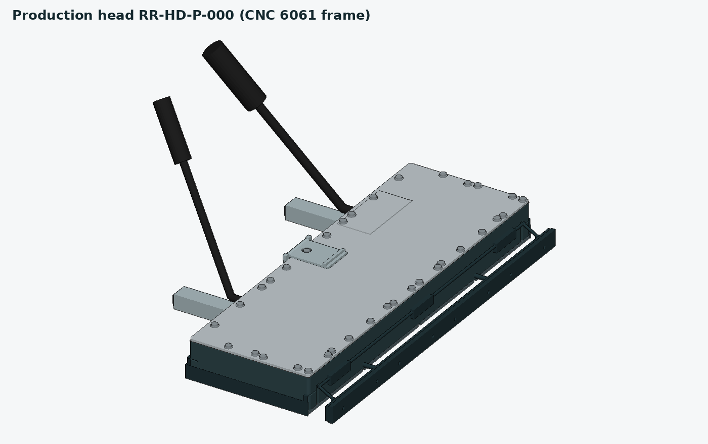

# Assembly -- production head RR-HD-P-000 (CNC 6061 frame)

Generated by `mechanical/head/docs.py`; images from `drawings.py steps_production` (`production/assembly/`). Parts: `production/bom_production.csv`.
Mass 2067 g, CG (119.8, 0.3, 32.8) mm (calculated). Same sequence as the prototype (`prototype/assembly.md`) with these differences:
one-piece frame (no dowels, no tongue), 0.5 mm aluminium bond shims instead of the G10 isolators, no EMI fences (the black-anodised frame with masked bond lands
is the enclosure), tapped threads instead of inserts, MJF PA12 lane parts, POM rail inserts and bail blocks, moulded silicone grommets, conductive lid gasket.

## Torques

| Joint | Prototype | Production |
|---|---|---|
| M2.5 into heat-set insert (printed) | 0.35 N m | 0.45 N m into tapped 6061 |
| M3 into heat-set insert (printed lid bosses) | 0.5 N m | 0.9 N m into tapped 6061 |
| M3 lid screw into aluminium standoff | 0.6 N m | 0.6 N m |
| M3 low-head into the T-head (aluminium) | 0.9 N m | 0.9 N m |
| M4 bridge to T-head ears | 2.0 N m | 2.0 N m |
| M2.5 board screws | 0.35 N m | 0.35 N m |
| cassette M2.5 CSK | 0.3 N m | 0.45 N m |

## Sequence

1.  Frame on the fixture (shoe datums A/B/C); shoes with bond shims, rear bridge (M4 2.0 N m).
2.  Side rails, guide pins, side switches (preset 0.40 mm), rods, springs, stop pins.
3.  Lane kits from above; stack-height check.
4.  Spreader (heater, pads, rib gaskets bonded), standoffs (11 mm), board, cans, switches, grommets, desiccant, cut-out, NTC.
5.  Lid with conductive gasket, 35 x M3 + bonded washers (18 into tapped frame bosses), blister, keeper.
6.  Cassettes (CNC 6061, black anodise) and leading rail.

Overview: 

End-of-line tests: `production/README.md` section 6.
