# Assembly -- prototype head RR-HD-X-000 (printed PA-CF frame halves)

Generated by `mechanical/head/docs.py`; images rendered from the model by `drawings.py steps` (`prototype/assembly/`). Parts and quantities:
`prototype/purchased_and_fabricated.csv`. Mass 1881 g, CG (127.2, -0.1, 34.0) mm base_link (calculated).

## Torques and thread rules

| Joint | Prototype | Production |
|---|---|---|
| M2.5 into heat-set insert (printed) | 0.35 N m | 0.45 N m into tapped 6061 |
| M3 into heat-set insert (printed lid bosses) | 0.5 N m | 0.9 N m into tapped 6061 |
| M3 lid screw into aluminium standoff | 0.6 N m | 0.6 N m |
| M3 low-head into the T-head (aluminium) | 0.9 N m | 0.9 N m |
| M4 bridge to T-head ears | 2.0 N m | 2.0 N m |
| M2.5 board screws | 0.35 N m | 0.35 N m |
| cassette M2.5 CSK | 0.3 N m | 0.45 N m |

Heat-set inserts only in the printed parts (no thread forming in polymer); medium thread-lock on every screw that is not a service screw (service screws:
lid, cassettes, rail inserts). All lid screws carry a bonded sealing washer.

## Sequence

**1. Frame halves, shoes, isolators, rear bridge** -- 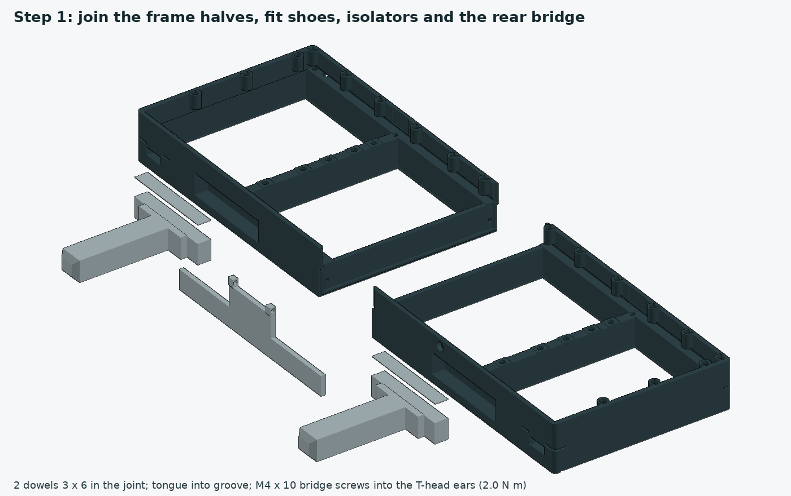
Fit the two 3 x 6 dowels in the left half; slide the tongue into the groove; seat the halves on a surface plate (underside down) and check the joint gap <= 0.1 mm.
Drop each shoe T-head into its pocket with the 0.5 mm G10 isolator on top (FRAME isolated from the shoes, see production/README.md section 4). Rear bridge on
the T-head ears, 4 x M4 x 10.

**2. Side rails, guide pins, side switches; rod springs, guide rods, stop pins** -- 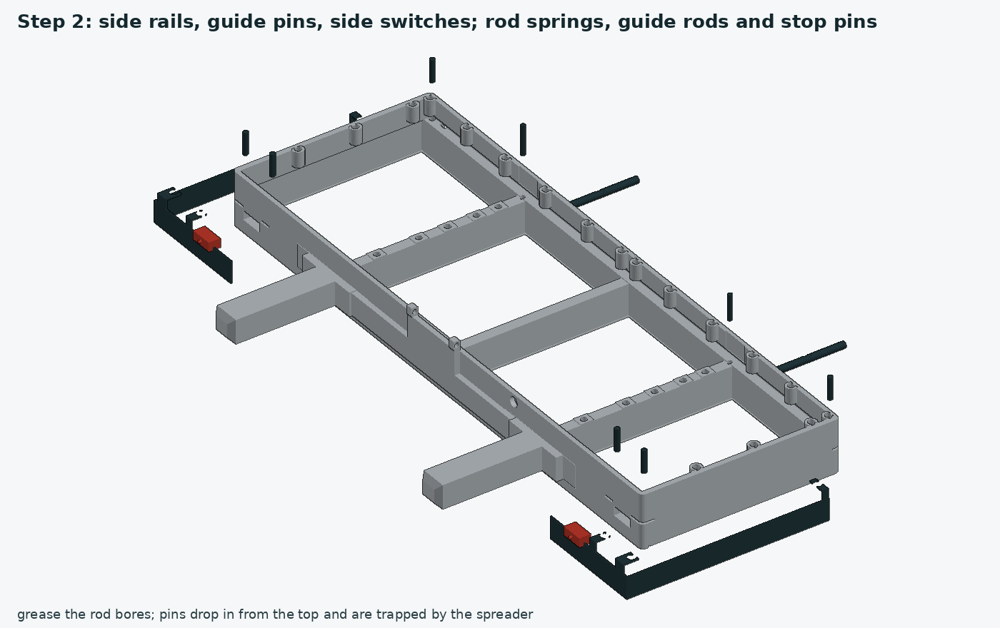
Side switches into their pockets (plunger to the rear), leads through the channel, pot the channel with black RTV after the loop test. Rail L-strips onto the
45 deg slots, M3 guide pins from the top (trapped later by the spreader). Grease the rod bores; spring, rod, stop pin. Set the side-zone adjusting screw to a
0.40 +- 0.15 mm plunger preset (feeler on the plunger).

**3. Lane kits** -- 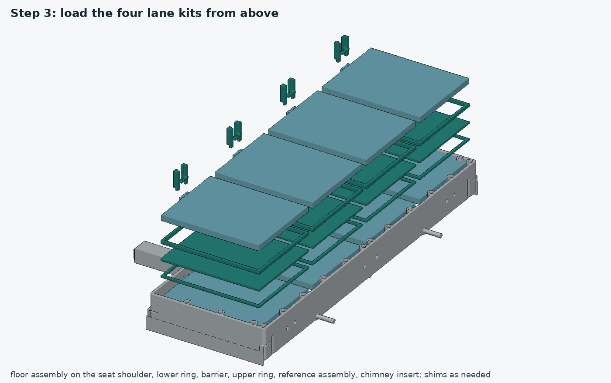
Per lane, from below upward: floor assembly on the 0.5 mm seat shoulder, lower ring, barrier plate, upper ring, reference assembly; SiPM carriers into the
chimney, chimney insert (fingers onto the carriers), coax up through the insert channel. Stack-height check with the depth gauge: reference top z 28.5
(shims 0.25 / 0.5 / 1.0 under the pad, see head_report.md section 8).

**4. Spreader** -- 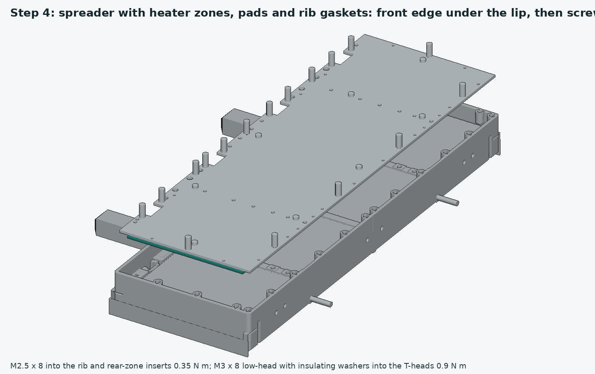
Heater zones, pads and rib gasket strips are bonded to the spreader underside beforehand; thermal cut-out and NTC on the top. Tilt the spreader in with its front
edge under the frame lip, lower it, then: 10 x M2.5 CSK into the rib inserts, 6 x M2.5 pan into the rear-zone inserts (they also clamp the EMI comb foot -- fit
the comb first in step 5 order if preferred), 8 x M3 low-head with insulating shoulder washers into the T-heads. Lid standoffs from below with M3 x 6 CSK
(9 x 10.5 mm on fence feet, 8 x 11 mm in the chimney zones; none in the J1 plug zone
y 62..113 except (77.5, 90.3) between the J2001 and J2601 wire groups, stage 3). Board standoffs are clinched in the spreader (H1 at (113.2, 87.5), CR-M02).
Thermal cut-out (isolated-case type) on a 0.1 mm polyimide pad at (77..81.6, 81..87.5); NTC lug on a polyimide pad with a nylon M3 screw (review M5).

**5. EMI fences, board, shield cans, switches, cables** -- 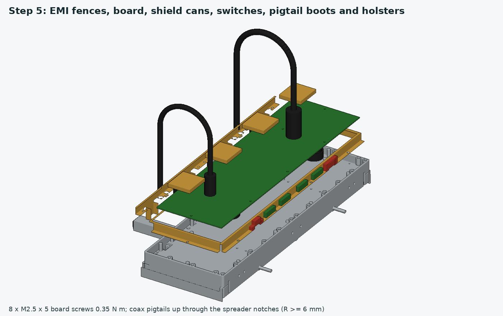
Rear comb (liners into the chimneys around the coax), side and front fences; their feet are clamped by the standoffs and screws (bond points <= 50 mm,
tool-checked); on the +y middle foot (under the J1 plugs) 2 x M2.5 x 3 pan at (80.3, 70.5) / (80.3, 104.5) into the tapped spreader -- fit them BEFORE the board. Front-switch saddle (shim the trip point: see section "Checks"), lid-switch saddle. Board on the eight standoffs (8 x M2.5 with serrated
washers = FRAME bond), lane shield cans clipped on, coax to the board rear edge (bend radius >= 6 mm). J1 / J2 pigtails through the split grommets into
the lid slots into the two boots (review M6): J2001 wires turn into the rear strip, run +y and rise at y 79.5 into the J1 boot; J2501 wires rise right
behind the plug (rear-comb flange notch y -106..-92) into the J2 boot. Jacket end clamped and potted in each boot (the boot is the strain relief and the only
clip point; nothing is clipped to the shoe root). Lengths: out/lead_routes.yaml. Plugs parked in their holster cups until the head is docked and latched.
**Insulation check (review M5), before the board is connected:** 100 V insulation tester between the heater circuit (J2601 plug pins: element, cut-out,
NTC leads, shorted together) and the spreader: >= 10 MOhm. Record the value.
Rail-switch leads to J2002 (front), J2003 (left), J2004 (right, u 144.6 = y +18.4, S2-L6), J2201 (lid): cut lengths in head_report.md section 12. Desiccant pouches into the front strip, indicator card visible.

**6. Lid** -- 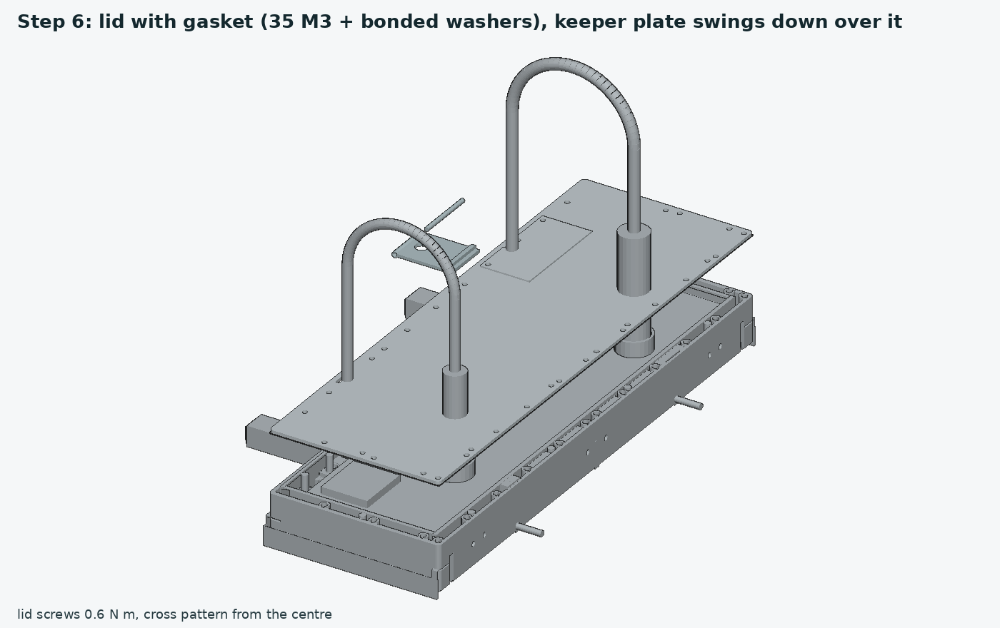
Lid gasket on the wall top land, liner under the lid. 35 x M3 button head + bonded washer: 17 into the standoffs, 18 into the wall bosses; tighten from the
centre outward. Blister (J1 landing and mated-plug clearance, 8.9 mm) is bonded over the lid opening, clamped by the three rear screws at y 57.0 / 90.3 / 117.5 and riveted at the front. Keeper plate swings down over the lid (its
hole clears the screw at (77.5, 0); 0.1 mm polyimide tape on the lid under it), hinge pin with circlips. **Insulating jacket (standard cold configuration,
required below 0 C):** degrease the lid and the frame front face, press the cap RR-HD-S-131 onto the lid (PSA; its 9 mm holes line up with the 35 lid screws, so
the lid is later removed with the cap on it; cut-out round the keeper and the latch box) and the front band RR-HD-S-132 onto the front face above the bail blocks.

**7. Window cassettes (underside)** -- 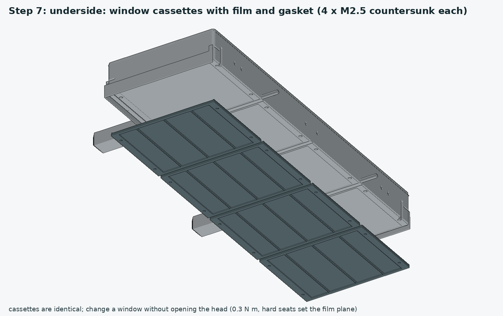
Film bonded to the cassette land beforehand (transfer adhesive, no wrinkle; pinhole check over a light box). Cassette gasket on the frame underside, cassette
with 4 x M2.5 CSK; the hard seat bosses set the film plane (z 10.00). A cassette is changed without opening the head.

**8. Leading rail** -- 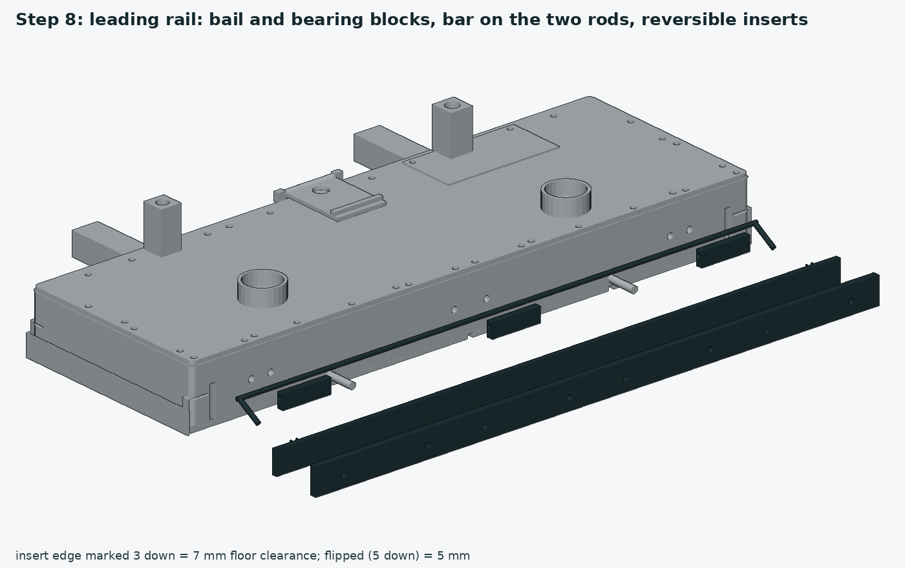
Bail into the three bearing blocks, blocks onto the frame front face (6 x M2.5), bar onto the two rod ends (2 x M3), bail clips riveted to the bar, inserts
with the "3 DOWN" edge marking for 7 mm floor clearance (flip for 5 mm). Side strips: RR-HD-S-431/432 (3 mm) or RR-HD-S-433/434 (5 mm), same holes.

**9. Transport cover** -- 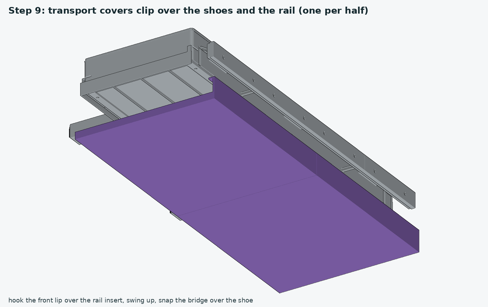
One clip-on cover per half: hook the front lip over the rail insert, swing up, snap the bridge over the shoe behind the x-stop shoulder. The rests touch the
cassette borders only (tool-checked clear of films, shoulders and wing returns).

Overview: 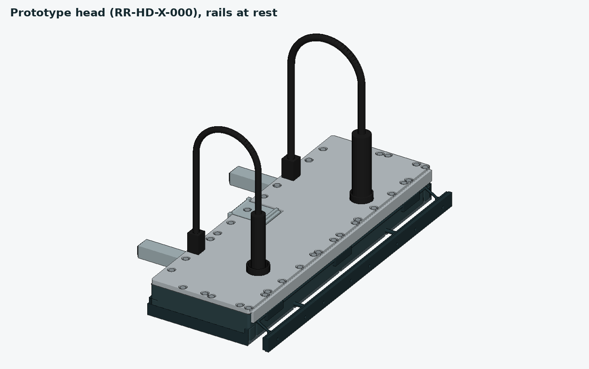 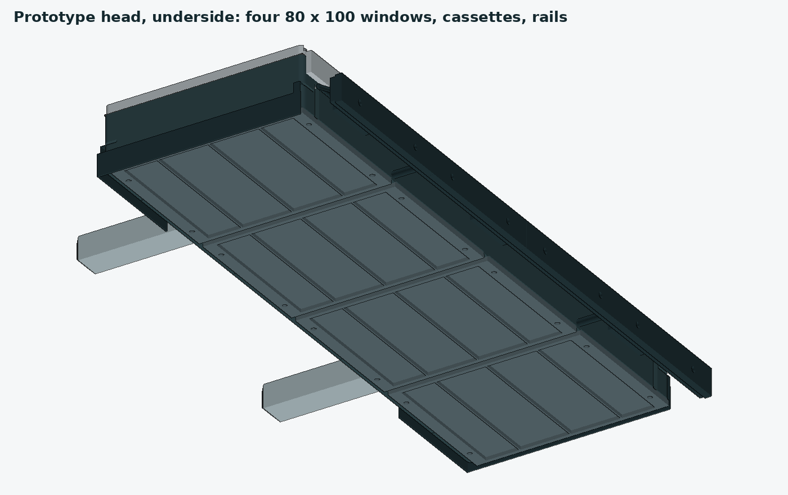

## Checks at the end of assembly (prototype)

1. Rail: push the bar with a force gauge: trip at <= 2.0 mm (calculated 1.13 nominal / 1.38 max),
   continue to the stop: >= 15 mm after trip (calculated 15.6); return force 3.0 N at rest. Shim the saddle (0.1 / 0.2 mm) if the trip is late.
2. Side zones: trip before the stop at 0.95 mm lateral (feeler + loop meter).
3. HEAD_LOOP across J1 pins 5/6: 1.00 kOhm +-1 %, open when any zone is pressed; PRES_ID 4.70 kOhm pin 7 to 2.
4. Standoff height / film plane: on the bench cradle, gap gauge at the four outer window corners 10.00 +- 0.30 (prototype trimmed with the 0.40 / 0.50 / 0.60 isolator).
5. Dark-count light-tightness test (production/README.md section 6, test E1) before the first source run.
