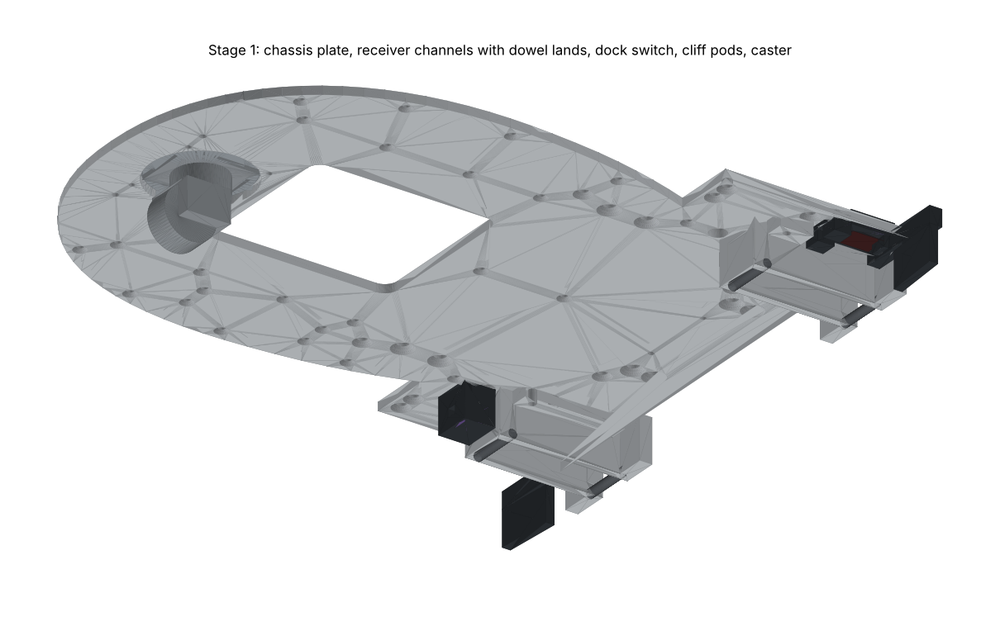
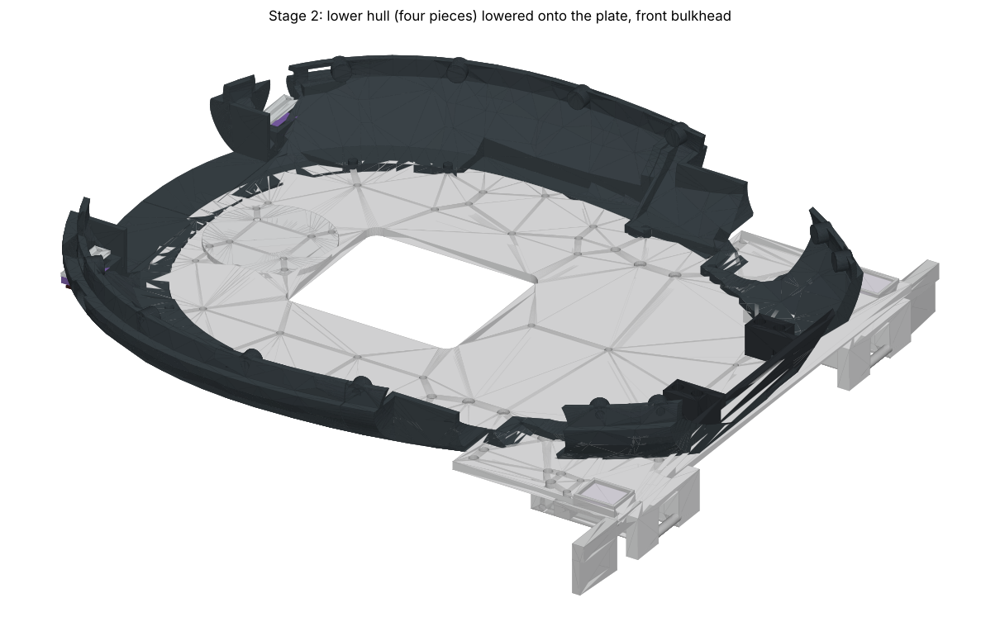
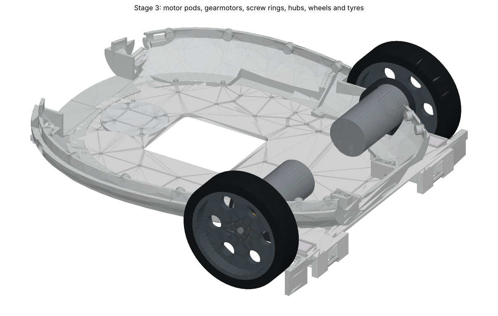
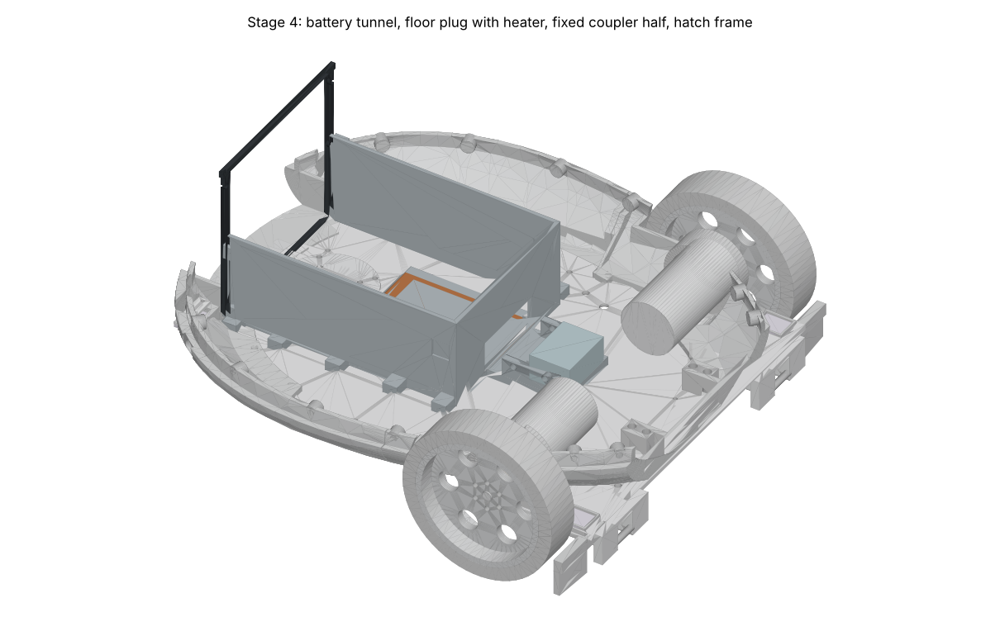
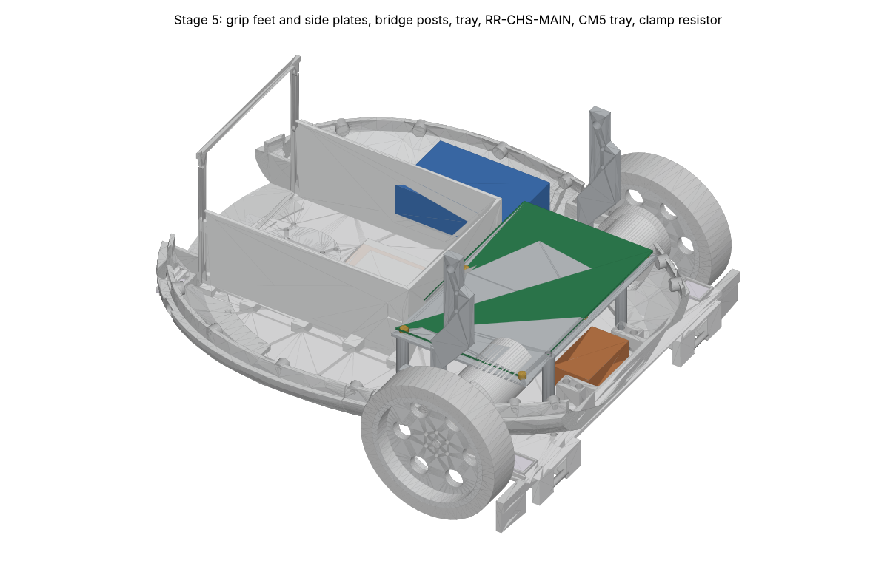
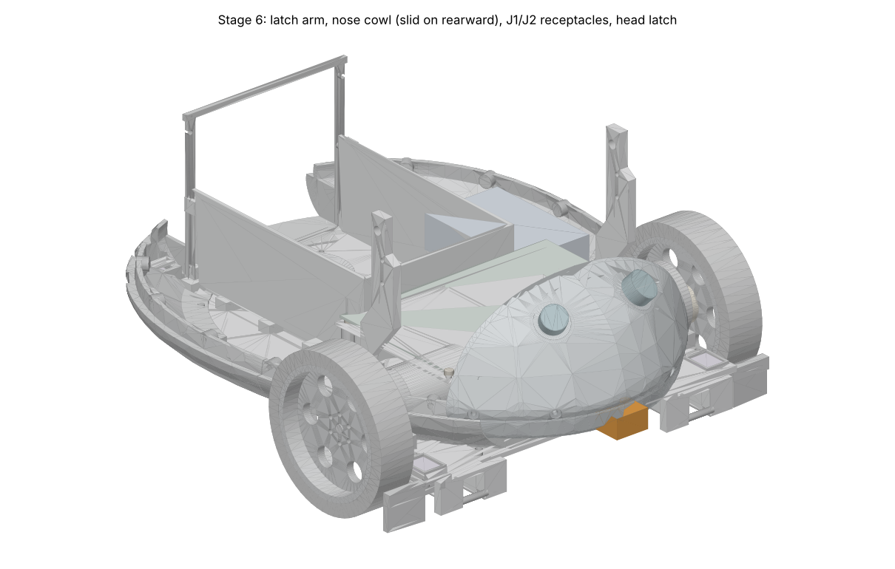
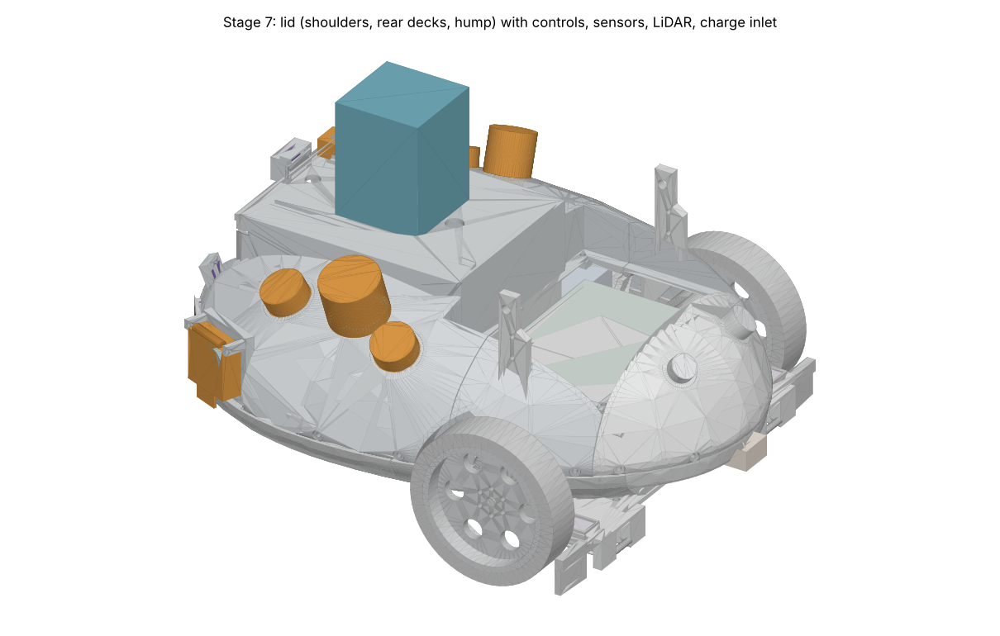
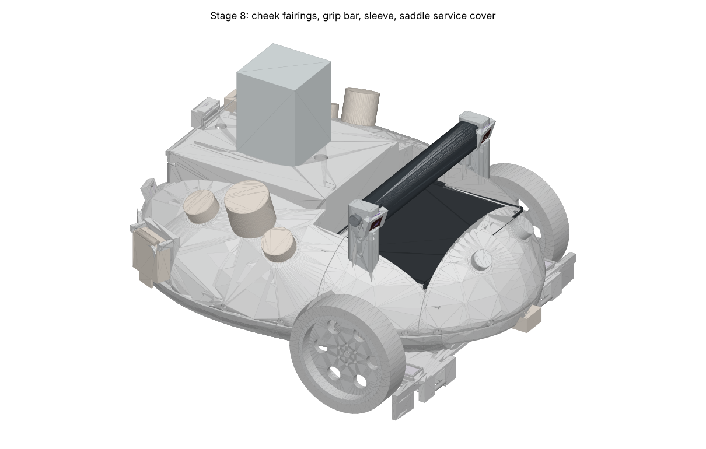
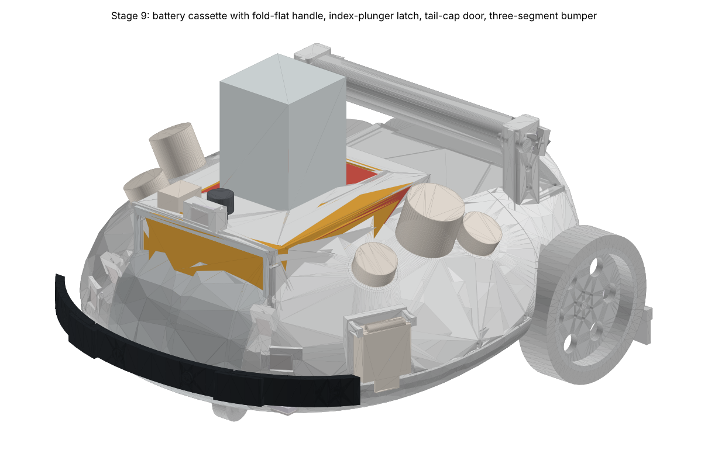
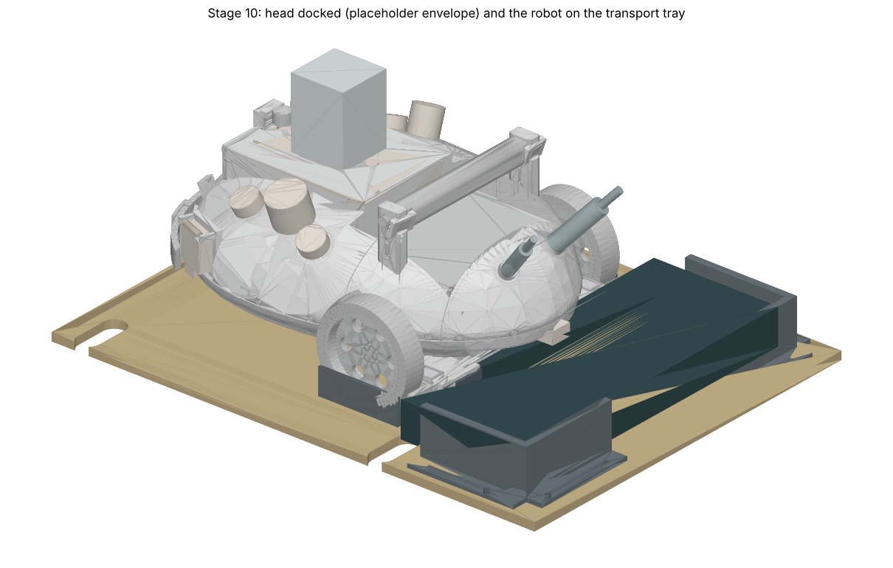

# RR-X prototype body -- assembly sequence

Generated by `rrx/docs.py` from the model (stage images `img/step_*.png` are rendered from the CAD: the new parts of each stage in colour, earlier parts grey). Fastener list by sub-assembly with quantities: `hardware_by_subassembly.md`; full parts list: `purchased_and_fabricated.csv`; joint sections at 1:1: `joints/README.md`.

## General rules

- **Heat-set inserts** go in before any part is assembled: soldering iron with the matching insert tip, ASA 220-235 C, PAHT-CF 240-250 C (dry the part first), press square to 0.1 mm proud then flatten with a cold flat tip; pull-test one coupon per batch (M3 target >= 400 N in ASA, the value the grip misuse case uses at 600 N is UNVERIFIED until tested).
- **Screws into inserts**: M2 0.15, M2.5 0.3, M3 0.5-0.6, M4 1.5, M5 2.5 N m. Into aluminium (tapped): M3 0.8, M4 2.2, M5 3.0-4.0 N m. Stainless into aluminium: anti-seize, or medium thread-lock where stated.
- **Gaskets** (closed-cell silicone, -40 C): fit dry, butt joints scarfed 45 deg and glued with silicone adhesive; never stretch the strip round corners.
- **Cold**: assemble and torque at room temperature; re-check the M5 grip and M4 receiver torques after the first -20 C soak (aluminium/steel differential is small; printed parts creep).
- Work order follows the load path: plate and datum first, then everything that is screwed from below, then the lid, cover and the removable items.

## Stage 1: chassis plate, receiver channels with dowel lands, dock switch, cliff pods, caster

Parts added (18): chassis_plate, receiver_channel_L, land_pin_L0, land_pin_L1, receiver_channel_R, land_pin_R0, land_pin_R1, dock_switch_bracket, caster_disc, caster_shim, cliff_pod_L, cliff_pod_R, tof_window_cliff_fl, tof_window_cliff_fr, caster, tof_cliff_fl, tof_cliff_fr, head_dock_switch.

1. Deburr the plate; countersink from BELOW and tap per `out/dxf/chassis_plate_holes.csv` (hole table). Ream the four 4 H7 dowel holes of the receiver in one set-up with the hole pattern.
2. Press the two 4 m6 x 10 locating dowels into each channel ear; press the two hardened 4 m6 x 24 land pins through each channel (they are the z datum C: flush both sides, no burr on the top line).
3. Fit each channel to the plate underside on its dowels; 3 x M4 x 10 cap screws from above, medium thread-lock.
4. Dock switch: D2HW-C201M into the bracket pocket (2 x M2 into inserts), 3 mm push pin into the left channel end wall, bracket to the plate (2 x M3 from above).
5. Cliff pods: RR-TOF boards with light-blocker foam into the pods, IR window bonded in its recess (clear silicone, no squeeze-out over the aperture); pods to the plate (3 x M3 each).
6. Caster: 2.5 mm stainless disc on the plate TOP over the 48 mm hole (4 x M3 countersunk into the tapped plate); 1 mm shim and caster from below through the hole, 4 x M4 pan head into the tapped disc (thread-lock).

**Inserts / torques:** Inserts: dock switch bracket 2 x M3, cliff pods 3 x M3 each (set at 230-245 C tip for PAHT-CF, flush +-0.1). Torques: M4 receiver 2.2 N m, M3 0.6 N m, M4 caster 1.5 N m.

**Harness:** Cliff ToF and dock switch leads up through the two 8 mm grommets at x = -2, y = +-80. Leave 150 mm coiled on top of the plate.

**Check before the next stage:** Slide a 16.00 x 14.00 x 70 mm gauge bar (the head-shoe gauge) the full length of each channel: left channel no perceptible y shake, right channel 0.6 mm total y float; 0.06 mm feeler fits under the roof pad, 0.12 mm does not. X-stop faces coplanar within 0.05 mm (straight edge + feelers). Dock switch clicks in the last 1.5 mm of gauge travel (continuity meter).

## Stage 2: lower hull (four pieces) lowered onto the plate, front bulkhead

Parts added (11): front_bulkhead, lower_hull_FL, lower_hull_FR, lower_hull_RL, lower_hull_RR, tof_clip_cliff_rl, tof_window_cliff_rl, tof_clip_cliff_rr, tof_window_cliff_rr, tof_cliff_rl, tof_cliff_rr.

1. Set all inserts in the four hull pieces first (sole ring, tongue, bumper-switch seats).
2. Butter the x = -71 butt faces with RTV (no splice screw: the joint lies in the CM5 bay).
3. Run a bead of neutral-cure RTV round the plate edge, lower each hull half onto the plate (the sole ring wraps the plate edge) and screw from below (M3 x 8 countersunk into the sole inserts). Close the y = 0 butt seams on the floor with RTV.
4. Front bulkhead on the plate at the chin cut (its pedestals take the latch-arm bolts in stage 6).
5. Rear cliff ToF boards into the hull bosses with their clips (2 x M2 each).

**Inserts / torques:** Inserts: M3 in the sole ring and tongue (ASA: 220-235 C tip), M2 in the ToF seats. Torque M3 into ASA inserts 0.5-0.6 N m (stop at first resistance + 1/8 turn).

**Harness:** Nothing routed yet; rear cliff leads coiled inside.

**Check before the next stage:** Underside flush with the plate (no step > 0.3 mm a broom could catch); lower land at z = 61.9 continuous across the four pieces (straight edge, gap <= 0.3 mm).

## Stage 3: motor pods, gearmotors, screw rings, hubs, wheels and tyres

Parts added (12): motor_pod_L, screw_ring_L, motor_pod_R, screw_ring_R, wheel_rim_L, tyre_L, wheel_hub_L, wheel_rim_R, tyre_R, wheel_hub_R, motor_L, motor_R.

1. Insert each gearmotor into its pod from inboard, gearbox face against the pod end wall; 6 x M3 x 6 button head through the stainless screw ring (use whichever of the two printed clockings matches the motor).
2. O-ring cord in the pod skin notch; lower the pod+motor into the hull and screw it to the plate from below (4 x M4 x 12 countersunk).
3. Hub on the D shaft, flat face outboard, two set screws on the flat (thread-lock); then the wheel rim onto the hub from outboard (6 x M3 x 8), tyre pre-bonded on the rim keys.

**Inserts / torques:** Inserts: 4 x M4 per pod (PAHT-CF). Torque M4 1.5 N m; motor M3 0.5 N m (<= 3 mm thread engagement: use the 6 mm screws only).

**Harness:** Motor + encoder leads up the pod notch into the left / right gutter (z 84..92 along the hull wall, x -69..-5); cable-tie to the gutter clips, 20 mm service loop at the pod.

**Check before the next stage:** Wheels spin freely by hand, tyre run-out < 0.5 mm radial (dial gauge), both tyre bottoms and the caster wheel on a surface plate within 0.3 mm (feeler under each).

## Stage 4: battery tunnel, floor plug with heater, fixed coupler half, hatch frame

Parts added (5): battery_tunnel, floor_plug, hatch_frame, coupler_fixed, chassis_heater_pad.

1. Insulating floor plug into the plate window (RTV the flange), heater pad on the plug, NTC beside it; bimetal cut-out screwed to the plate under the tunnel foot.
2. Tunnel onto the plate (10 x M3 x 8 countersunk from below), fixed SBS50 half into the cradle and cross-pinned (2 x M4 x 55 + nyloc).
3. Hatch frame onto the tunnel end bosses (4 x M3 x 10).

**Inserts / torques:** Inserts: tunnel feet 10 x M3, end bosses 4 x M3, cradle 2 x M3. Torque M3 0.6 N m, M4 cross pins 1.0 N m (snug: the housing is plastic).

**Harness:** Pack feed + aux leads from the fixed coupler half along under_bridge_right to the right gutter (2-into-1 loom to J_PWR, CCR-E08), heater/NTC leads with them; P-clip at the cradle (strain relief).

**Check before the next stage:** An empty cassette slides in and out with no binding; key rib reversed = blocked at the gate; coupler halves mate by hand.

## Stage 5: grip feet and side plates, bridge posts, tray, RR-CHS-MAIN, CM5 tray, clamp resistor

Parts added (19): grip_side_plate_L, grip_foot_L, grip_side_plate_R, grip_foot_R, bridge_tray, bridge_post_0, bridge_post_1, bridge_post_2, bridge_post_3, board_standoff_0, board_standoff_1, board_standoff_2, board_standoff_3, board_standoff_4, board_standoff_5, cm5_tray, bus_clamp_resistor, RR-CHS-MAIN_pcb, CM5_carrier_assembly.

1. Grip feet (angle) on the plate: 2 x M5 x 16 countersunk from below + nyloc above each; side plates to the feet (2 x M5 x 16 cap + nyloc).
2. Four bridge posts (M4 from below), bridge tray on top (M4 x 8), gap pad on the tray under the bridge zone, RR-CHS-MAIN on 3 mm spacers (6 x M3 + nyloc under the tray; H1 and H3 bond to chassis).
3. CM5 tray (4 x M3 from below), CM5 carrier (4 x M2.5), clamp resistor (2 x M3 into the tapped plate, thermal paste).

**Inserts / torques:** Torques: M5 grip 4.0 N m (proof-load path: no thread-lock substitutes for the nyloc), M4 1.5 N m, M3 0.5-0.6 N m.

**Harness:** Now connect in this order: (1) J_PWR (right rear edge, the only Mini-Fit) -- 12 mm clear height over the inboard top-entry headers must be kept free of loom; (2) motor connectors J_MOT_L/R from the gutters; (3) cliff and dock leads from the grommets via front_bay; (4) CM5 USB x2 + Ethernet over left_bay_over_cm5; (5) rear-left corner headers (panel, mode, buttons, bumper, rear ToF) via hump_side_left; (6) rear-right corner headers (E-stop, HANDS-ON, cover, NTC, heater). Every lead tie-wrapped within 40 mm of its header.

**Check before the next stage:** Grip side plates vertical within 1 deg; board lies flat (no rocking on the six spacers); continuity board H1/H3 to plate < 0.1 ohm.

## Stage 6: latch arm, nose cowl (slid on rearward), J1/J2 receptacles, head latch

Parts added (5): latch_arm, nose_cowl, J1_receptacle, J2_receptacle, head_latch.

1. Latch arm onto the bulkhead pedestals (4 x M5 x 25 countersunk from below through the plate).
2. Nose cowl: J1/J2 receptacles fitted first (O-ring on the outside face, nut inside); slide the cowl rearward over the latch arm until its flange meets the shoulders line (x = 47).
3. Draw latch through the chin floor into the tapped arm (4 x M4).

**Inserts / torques:** Torques: M5 3.0 N m; M4 latch 2.0 N m; receptacle nuts per binder (UNVERIFIED, typ. 1.0-1.5 N m).

**Harness:** J1/J2 internal leads down the nose cavity through front_bay to the board front edge.

**Check before the next stage:** With a head (or the 16 x 14 shoe gauge bars + a latch keeper dummy) the latch closes with a clear over-centre snap; 45 mm glove ring round each coupling nut free (feel with a gloved hand).

## Stage 7: lid (shoulders, rear decks, hump) with controls, sensors, LiDAR, charge inlet

Parts added (40): door_peg_L, door_peg_R, shoulder_L, rear_deck_L, shoulder_R, rear_deck_R, battery_hump, panel_tray, inlet_cover, tof_clip_look_rl, tof_window_look_rl, tof_clip_look_rr, tof_window_look_rr, tof_clip_prox_rc, tof_window_prox_rc, tof_clip_prox_rl, tof_window_prox_rl, tof_clip_prox_rr, tof_window_prox_rr, lidar, RR-PANEL, estop_operator, estop_body, hands_on_operator, hands_on_body, mode_selector_operator, mode_selector_body, rearm_start_operator, rearm_start_body, pause_stop_operator, pause_stop_body, charge_inlet, tof_look_rl, tof_look_rr, tof_prox_rc, tof_prox_rl, tof_prox_rr, bumper_sw_l, bumper_sw_r, hatch_latch.

1. Pre-assemble the lid pieces off the robot: panel devices into the decks (anti-rotation notch), RR-PANEL on its tray with the light pipes, rear ToF boards and clips, charge inlet + cover + cover switch, bumper switches, door pegs, LiDAR on the hump (gasket, cable gland).
2. Perimeter gasket on the lower land; lower the shoulders over the grip side plates (slots), then the rear decks; dowels at x = -45 and x = 47; flange screws.
3. Hump down through the deck opening onto the tunnel; curb screws (M3 countersunk from inside), hatch-frame screw at the top.

**Inserts / torques:** Inserts: deck/shoulder flanges, perimeter tongue, hump curb, panel tray bosses, ToF seats. Radial perimeter screws M3 x 10 + bonded washer at 0.5 N m (do not crush the gasket below 1.5 mm).

**Harness:** Deck harness (controls, panel, rear ToF, LiDAR, inlet) into the board rear corners along hump_side_left / right_bay before the hump closes the space; service loop 60 mm so a deck half can be lifted 50 mm.

**Check before the next stage:** Perimeter land gap even all round (1.5-2.0 mm compressed gasket visible); every control actuates without touching the skin; E-stop latches and resets.

## Stage 8: cheek fairings, grip bar, sleeve, saddle service cover

Parts added (13): cheek_fairing_L, cheek_fairing_R, grip_bar, grip_screw_L, grip_screw_R, grip_sleeve, saddle_cover, tof_clip_look_fl, tof_window_look_fl, tof_clip_look_fr, tof_window_look_fr, tof_look_fl, tof_look_fr.

1. On the bench: look-ahead ToF board, foam blocker and window into each fairing nose, shallow clip from behind (2 x M2). Then the fairings over the side plates (2 x M3 x 20 through each).
2. Printed sleeve onto the 14 mm bar, bar between the side plates, one M6 x 16 cap screw + washer through each plate and fairing pocket into the tapped bar ends (thread-lock); push-in caps.
3. Saddle cover on its gasket ledge, 9 captive M3 screws.

**Inserts / torques:** Torque M6 into the 6061 bar 6.0 N m (medium thread-lock); captive cover screws 0.5 N m.

**Harness:** Look-ahead ToF leads down the fairing channel into the gutters.

**Check before the next stage:** PROOF LOAD (VT-002): hang 3 x 9 kg = 265 N on the bar centre over 100 mm for 60 s; no permanent set at the side plates, feet or plate (dial gauge on the plate edge < 0.1 mm residual).

## Stage 9: battery cassette with fold-flat handle, index-plunger latch, tail-cap door, three-segment bumper

Parts added (11): battery_cassette, cassette_lid, coupler_carrier, cassette_handle, cassette_plunger, hatch_door, bumper_side_L, bumper_side_R, bumper_centre, battery_pack, coupler_cassette.

1. Pack into the cassette with EPDM pads (terminals +y), leads to the floating SBS50 half on its carrier, lid (2 x M3).
2. Index plunger into the hump roof (O-ring under the flange, nut inside, before the hump is fitted in stage 7). Cassette in until the coupler seats and the plunger pin drops into the lid hole (audible click); handle folded down.
3. Hook the door onto the jamb pegs tilted back, swing shut, close the hatch draw latch; bumper segments on their guide screws with springs.

**Inserts / torques:** Inserts: cassette lid 2 x M3, handle hinge lugs 2 x M3 (shoulder screws), carrier 4 x M3, bumper guides 6 x M3.

**Harness:** None (the cassette harness is self-contained).

**Check before the next stage:** Door will NOT close unless the cassette is fully home (the door finger stops 0.5 mm behind the cassette rear face), and home = latched by the plunger; the draw latch pulls the door onto the gasket. Pull test: cassette does not move at 100 N on the handle with the plunger engaged. Each bumper segment trips its D2HW within 2-6 mm and returns by spring; 8 mm free stroke.

## Stage 10: head docked (placeholder envelope) and the robot on the transport tray

Parts added (11): tray_chock_L, tray_head_guard_L, tray_chock_R, tray_head_guard_R, tray_base, tray_caster_cup, J1_mated_plug, J2_mated_plug, head_envelope, head_shoe_L, head_shoe_R.

1. Dock the head: shoes into the channels from the front, push to the x-stops, close the draw latch; plug J1/J2.
2. For transport: robot onto the tray (wheels into the chocks, caster into the cup), head guards screwed on, straps over saddle and hump.

**Inserts / torques:** -

**Harness:** J1/J2 pigtails clipped to the shoe roots (head side).

**Check before the next stage:** HEAD_DOCK reads closed only with the latch closed and the head fully seated; head film gap per the head checklist.

## Harness routing order (summary)

Corridors are the reserved boxes of `mechanical/common/layout.py` (checked free in `out/prototype_report.md`): front_bay (J1/J2, front cliff, dock switch, clamp resistor), left/right gutter (motors, look-ahead ToF, CM5 power; pack and charge feed on the right), under_bridge_right (pack feed between the motor ends), left_bay_over_cm5 (CM5 USB/Ethernet), hump_side_left (LiDAR, RR-PANEL, rear ToF, deck controls), right_bay (charge inlet, HANDS-ON/Pause, right rear ToF, bumper). Order: plate-level leads (stage 1-4) -> board connectors in the stage 5 order -> nose (stage 6) -> lid (stage 7) -> grip ToF (stage 8). Strain relief: P-clip or tie-wrap within 40 mm of every board header, grommet at every plate pass-through, sealed glands at the LiDAR and at the J receptacles (connector seals), service loops where a lid piece must lift.

## Removal procedures (checked as sweeps in the report)

- **Battery**: open the hatch latch, lift the door off its pegs, pull the plunger knob on the hump (twist to its rest position), unfold the handle, pull 165 mm straight back (unmates the coupler).
- **Wheel**: 6 x M3 out of the rim web, pull the wheel 60 mm outboard; the hub stays on the shaft.
- **Head**: open the draw latch (lever forward/up), unplug J1/J2, slide the head 66 mm forward.
- **Service cover**: 9 captive screws, lift straight up under the bar, slide forward over the nose. The grip stays in place.

Grip proof-load design value: 264.9 N (calculated, see report section 8).

