# RR-X joint details (true-size sections cut from the CAD model)

Generated by `rrx/docs.py` (`render.section`): each image is the model cut by a 0.4 mm slab at the stated plane, drawn at 1:1 when printed at 254 dpi (PDF copies are vector-true-size). Colours are the part colours of the assembly; the legend lists the parts cut.

## J01 perimeter lap

Lid / lower hull perimeter lap joint at a screw station. Plane x = -122.0 mm, window (120, 152, 48, 80).

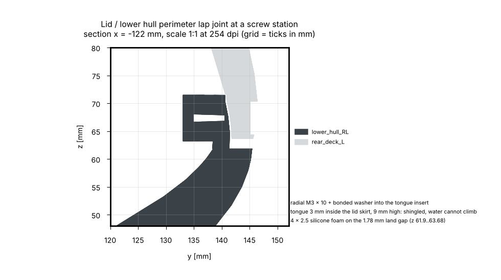

- 4 x 2.5 silicone foam on the 1.78 mm land gap (z 61.9..63.68)
- tongue 3 mm inside the lid skirt, 9 mm high: shingled, water cannot climb
- radial M3 x 10 + bonded washer into the tongue insert
- parts cut: lower_hull_RL, rear_deck_L

## J02 lid flange x-38

Shoulder / rear deck bolted flange joint (x = -38). Plane z = 100.0 mm, window (-56, -20, 96, 130).

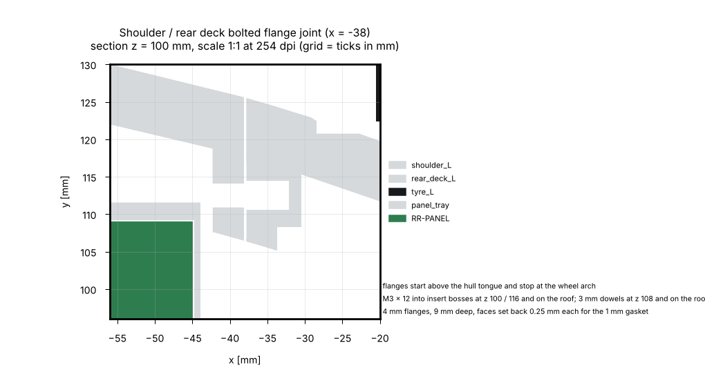

- 4 mm flanges, 9 mm deep, faces set back 0.25 mm each for the 1 mm gasket
- M3 x 12 into insert bosses at z 100 and on the roof; 3 mm dowels at z 108 and on the roof
- flanges start above the hull tongue and stop at the wheel arch
- parts cut: shoulder_L, rear_deck_L, tyre_L, panel_tray, RR-PANEL

## J03 nose flange x47

Nose cowl / shoulder flange joint (x = 47). Plane z = 74.0 mm, window (30, 64, 66, 98).

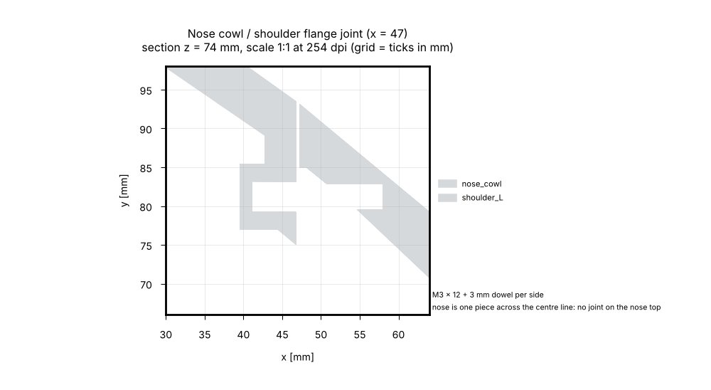

- nose is one piece across the centre line: no joint on the nose top
- M3 x 12 + 3 mm dowel per side
- parts cut: nose_cowl, shoulder_L

## J04 hump curb

Hump wall / rear deck coaming joint. Plane x = -124.0 mm, window (44, 80, 104, 154).

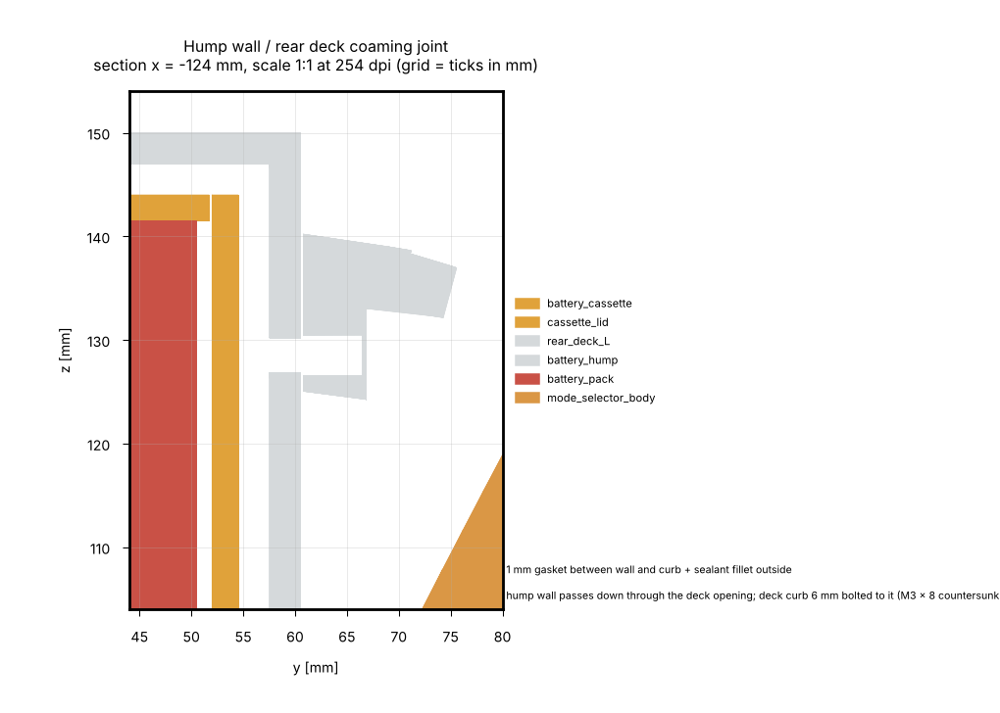

- hump wall passes down through the deck opening; deck curb 6 mm bolted to it (M3 x 8 countersunk from inside)
- 1 mm gasket between wall and curb + sealant fillet outside
- parts cut: battery_cassette, cassette_lid, rear_deck_L, battery_hump, battery_pack, mode_selector_body

## J05 saddle cover side

Saddle well wall, cover ledge, grip side plate through the shoulder slot, cheek fairing on the roof, grip bar. Plane x = -25.0 mm, window (66, 106, 90, 180).

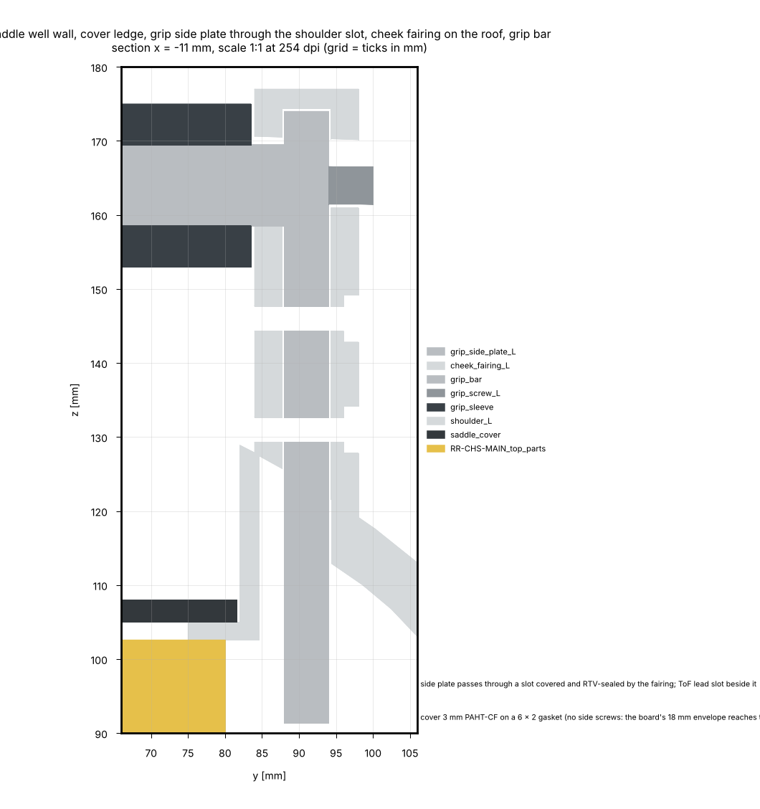

- cover 3 mm PAHT-CF on a 6 x 2 gasket (no side screws: the board's 18 mm envelope reaches the ledge)
- side plate passes through a slot covered and RTV-sealed by the fairing; ToF lead slot beside it
- parts cut: grip_side_plate_L, cheek_fairing_L, grip_bar, grip_screw_L, grip_sleeve, shoulder_L, saddle_cover, RR-CHS-MAIN_top_parts

## J06 cover rear corner

Saddle cover rear-corner captive screw into the rear-deck ledge boss over the board corner. Plane x = -65.5 mm, window (56, 92, 80, 115).

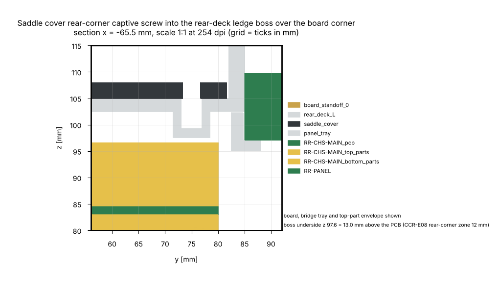

- boss underside z 97.6 = 13.0 mm above the PCB (CCR-E08 rear-corner zone 12 mm)
- board, bridge tray and top-part envelope shown
- parts cut: board_standoff_0, rear_deck_L, saddle_cover, panel_tray, RR-CHS-MAIN_pcb, RR-CHS-MAIN_top_parts, RR-CHS-MAIN_bottom_parts, RR-PANEL

## J07 hatch frame top

Hatch frame, door end-plate ring, hump end and draw latch (top of the hatch). Plane y = 35.0 mm, window (-252, -212, 118, 168).

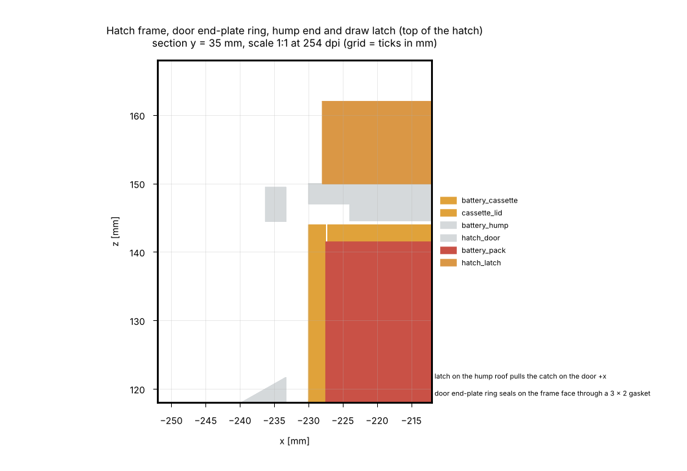

- door end-plate ring seals on the frame face through a 3 x 2 gasket
- latch on the hump roof pulls the catch on the door +x
- parts cut: battery_cassette, cassette_lid, battery_hump, hatch_frame, hatch_door, battery_pack, hatch_latch

## J16 cassette latch

Cassette latch: index plunger through the hump roof into the lid, folded handle, door interlock finger. Plane y = 0.0 mm, window (-252, -190, 36, 172).

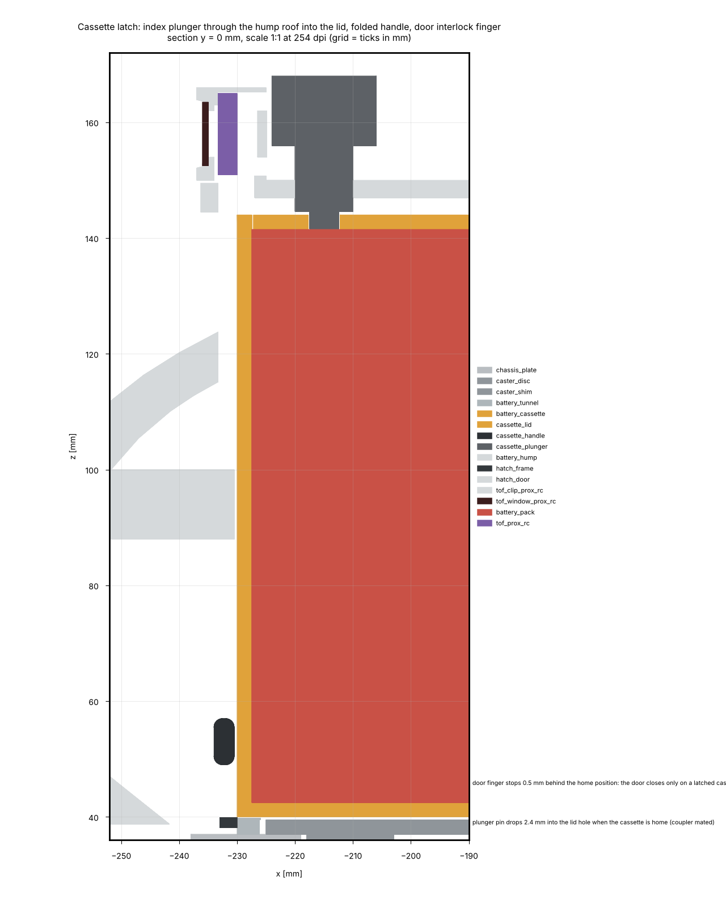

- plunger pin drops 2.4 mm into the lid hole when the cassette is home (coupler mated)
- door finger stops 0.5 mm behind the home position: the door closes only on a latched cassette
- parts cut: chassis_plate, caster_disc, caster_shim, battery_cassette, cassette_lid, cassette_handle, cassette_plunger, battery_hump, hatch_frame, hatch_door, tof_clip_prox_rc, tof_window_prox_rc, battery_pack, tof_prox_rc

## J08 door peg

Door hook slot on the jamb peg, jamb / frame joint. Plane z = 100.0 mm, window (-254, -224, 42, 72).

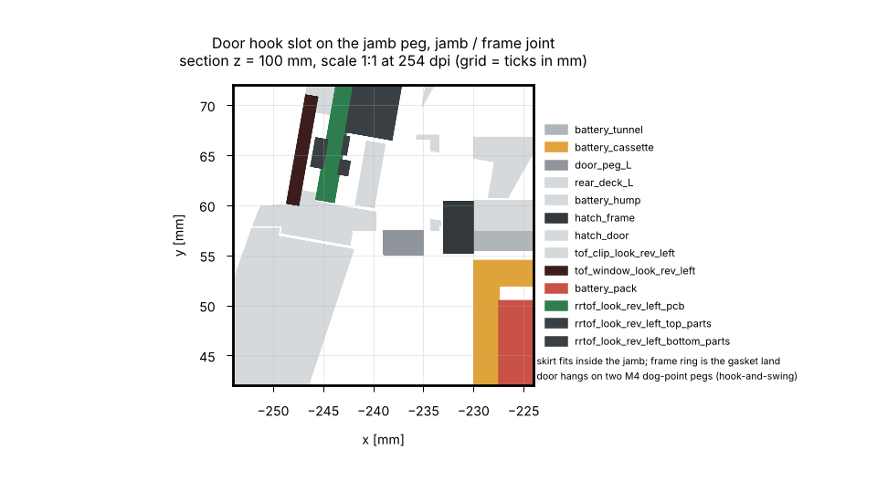

- door hangs on two M4 dog-point pegs (hook-and-swing)
- skirt fits inside the jamb; frame ring is the gasket land
- parts cut: battery_tunnel, battery_cassette, door_peg_L, rear_deck_L, battery_hump, hatch_frame, hatch_door, tof_clip_look_rev_left, tof_window_look_rev_left, battery_pack, tof_look_rev_left

## J09 sole plate edge

Lower hull sole ring on the chassis plate edge. Plane x = -162.5 mm, window (74.9, 110.9, 28, 48).

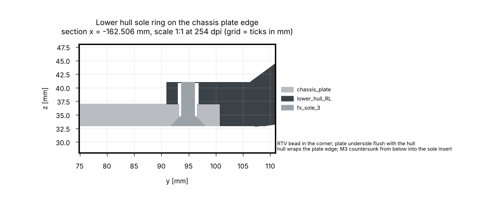

- hull wraps the plate edge; M3 countersunk from below into the sole insert
- RTV bead in the corner; plate underside flush with the hull
- parts cut: chassis_plate, lower_hull_RL

## J10 hull splice

Lower hull front / rear butt joint (x = -71) beside the CM5 bay. Plane z = 52.0 mm, window (-88, -54, 90, 148).

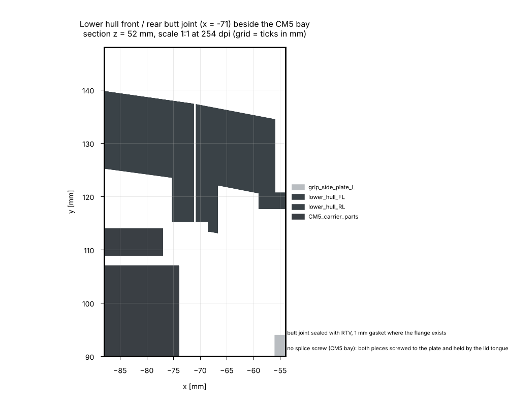

- no splice screw (CM5 bay): both pieces screwed to the plate and held by the lid tongue
- butt joint sealed with RTV, 1 mm gasket where the flange exists
- parts cut: grip_side_plate_L, lower_hull_FL, lower_hull_RL, cm5_tray, CM5_carrier_assembly

## J11 nose bulkhead latch

Front bulkhead, chin floor of the nose cowl, latch arm and draw latch over the head. Plane y = 0.0 mm, window (26, 112, 28, 72).

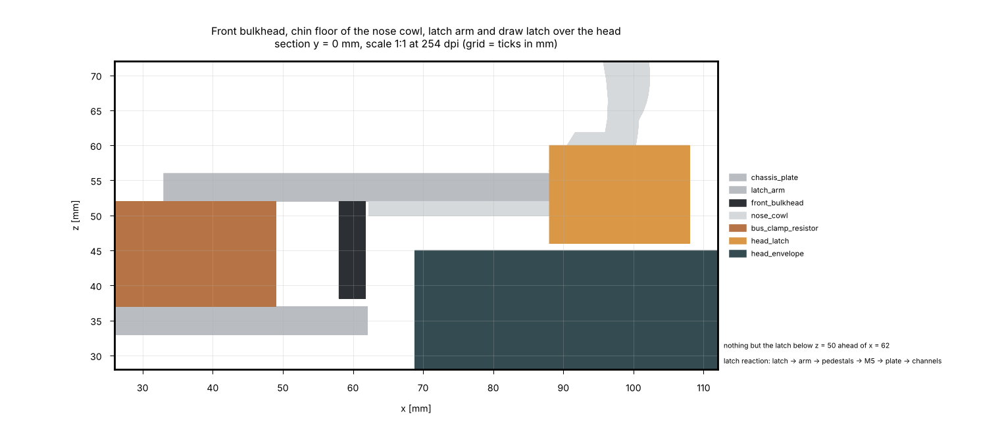

- latch reaction: latch -> arm -> pedestals -> M5 -> plate -> channels
- nothing but the latch below z = 50 ahead of x = 62
- parts cut: chassis_plate, latch_arm, front_bulkhead, nose_cowl, head_latch, head_envelope

## J12 receiver station

Receiver channel at the rear land station (x = 8) with the head shoe. Plane x = 8.0 mm, window (58, 118, 8, 40).

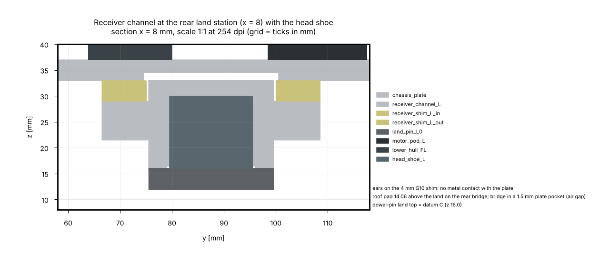

- dowel-pin land top = datum C (z 16.0)
- roof pad 14.06 above the land on the rear bridge; bridge in a 1.5 mm plate pocket (air gap)
- ears on the 4 mm G10 shim: no metal contact with the plate
- parts cut: chassis_plate, receiver_channel_L, receiver_shim_L_in, receiver_shim_L_out, land_pin_L0, motor_pod_L, lower_hull_FL, head_shoe_L

## J17 receiver break

Receiver thermal break, left inboard ear line: M4 in G10 top-hat bushings, lower and upper location pins, G10 shim. Plane y = 70.5 mm, window (0, 62, 16, 42).

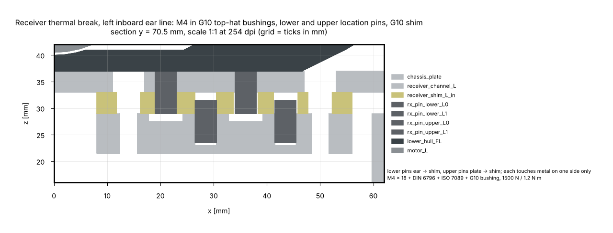

- M4 x 18 + DIN 6796 + ISO 7089 + G10 bushing, 1500 N / 1.2 N m
- lower pins ear -> shim, upper pins plate -> shim; each touches metal on one side only
- parts cut: chassis_plate, receiver_channel_L, receiver_shim_L_in, rx_pin_lower_L0, rx_pin_lower_L1, rx_pin_upper_L0, rx_pin_upper_L1, lower_hull_FL, motor_L

## J13 receiver long

Left receiver channel, longitudinal section: lands, x-stop flange, dock switch and push pin. Plane y = 87.5 mm, window (-16, 74, 8, 40).

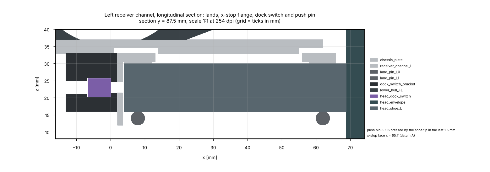

- x-stop face x = 65.7 (datum A)
- push pin 3 x 6 pressed by the shoe tip in the last 1.5 mm
- parts cut: chassis_plate, receiver_channel_L, land_pin_L0, land_pin_L1, dock_switch_bracket, lower_hull_FL, head_dock_switch, head_envelope, head_shoe_L

## J14 motor pod

Motor pod, gearmotor (shaft 7 mm below the can axis), screw ring, hub, wheel, tyre. Plane x = 0.0 mm, window (78, 152, 0, 110).

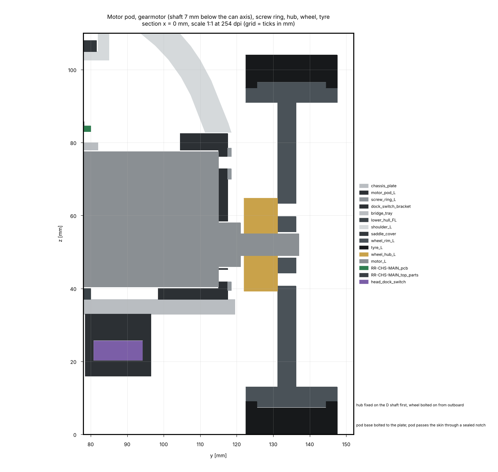

- pod base bolted to the plate; pod passes the skin through a sealed notch
- hub fixed on the D shaft first, wheel bolted on from outboard
- parts cut: chassis_plate, motor_pod_L, screw_ring_L, dock_switch_bracket, bridge_tray, lower_hull_FL, shoulder_L, saddle_cover, wheel_rim_L, tyre_L, wheel_hub_L, motor_L, RR-CHS-MAIN_pcb, RR-CHS-MAIN_top_parts, RR-CHS-MAIN_bottom_parts, head_dock_switch

## J15 bumper

Bumper: side segment on two guide pins with the D2HW, centre segment on the door with overlapping wings. Plane z = 66.0 mm, window (-292, -222, 50, 130).

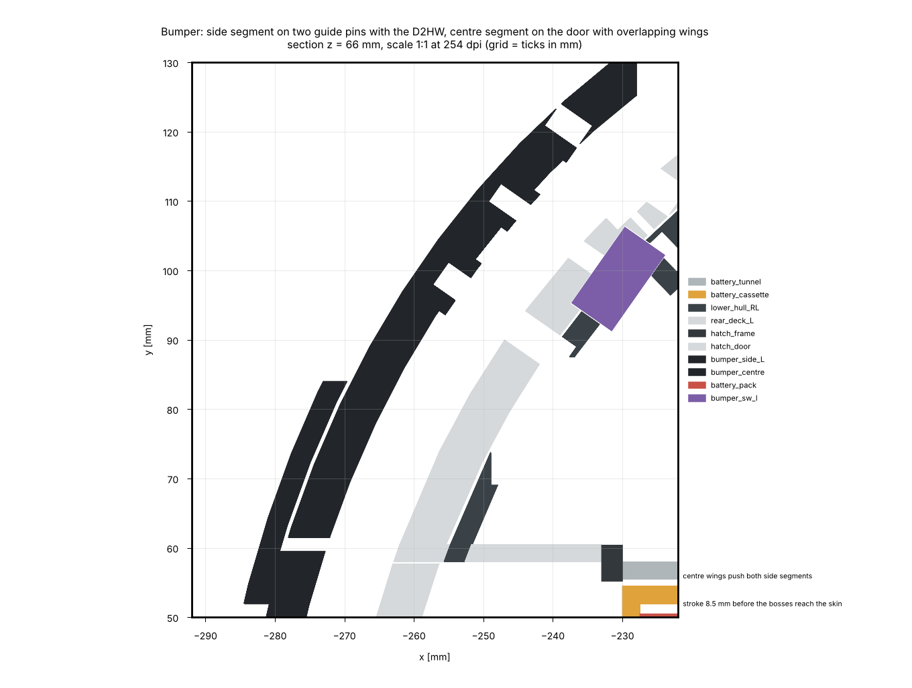

- stroke 8.5 mm before the bosses reach the skin
- centre wings push both side segments
- parts cut: battery_tunnel, battery_cassette, lower_hull_RL, rear_deck_L, hatch_frame, hatch_door, bumper_side_L, bumper_centre, battery_pack, bumper_sw_l

